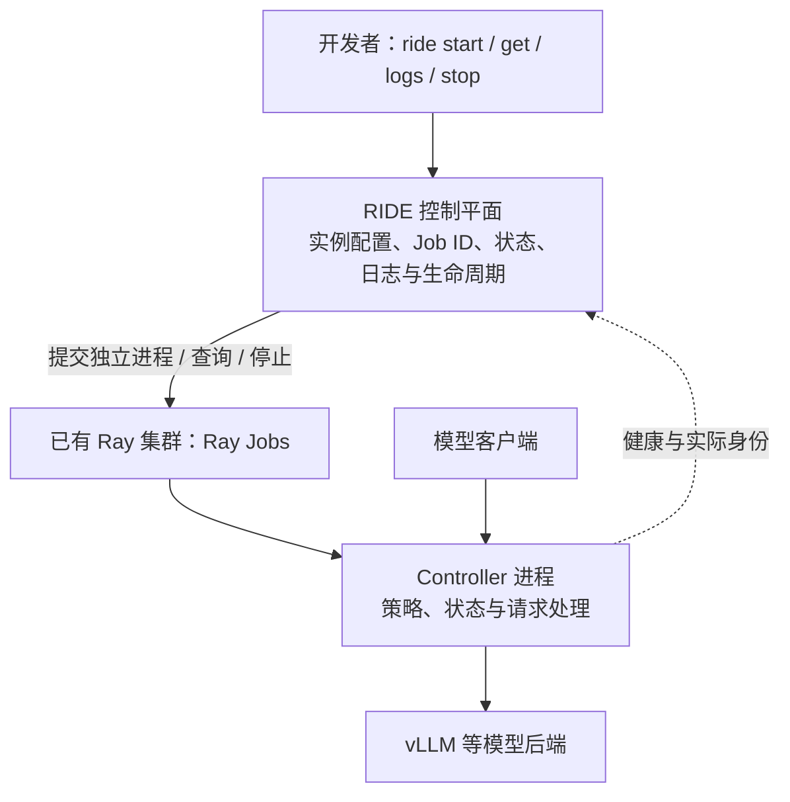

# Controller 开发与 RIDE 接入指南

目标是让开发者实现自己的 Controller，然后用统一命令将独立进程部署到已有 Ray。
RIDE 是控制平面；Controller 是策略与服务实现；Ray 是进程执行底座。
本指南区分当前已实现接口与未来扩展约定，不把约定当成已有插件能力。

## 1. 系统责任与运行路径



RIDE 负责配置校验、Ray Job 提交、资源与运行环境传递、实例持久化、重复启动保护、
仅停止自己记录的 Job、状态与日志查询。它不实现 Controller 的调度策略。
Controller 负责业务策略、业务状态、后端通信及自己的 HTTP 服务；不应自行创建或停止 Ray 集群。
图中的请求转发适用于 Request Throttling；其他 Controller 可以不在请求路径上，接入时需另定义其可观测接口。
Ray 已存在，由部署环境提供。Coder 管理工作区及访问入口，不承担 Controller 策略。

## 2. 开发一个独立 Controller 进程

Controller 使用独立 Python 包，提供可重复启动的进程入口，例如：

```sh
python -m your_controller --backend http://model-host:8000 --listen 0.0.0.0:9011
```

配置必须显式传入。不要在包导入时启动服务，也不要依赖 RIDE 工作目录中的隐藏状态。
将依赖版本、来源与兼容范围写入 Controller 自己的包配置和文档。
进程日志写到标准输出与标准错误，才能通过 `ride logs` 获取。
后台线程和连接应随进程退出释放；当前 `ride stop` 是 Ray Job 停止，不承诺 graceful drain。

当前 Request Throttling 的 RIDE 适配要求如下：

| 接口 | 当前读取方式与用途 |
|---|---|
| `GET /health` | HTTP 200，JSON 健康信息；后端 `/health` 也必须可达 |
| `GET /migration-identity` | JSON；`backends` 必须等于配置后端列表，`scheduling_enabled` 必须为 true |
| `GET /programs` | JSON，展示 Controller 的 program 状态 |
| 标准输出 / 标准错误 | Ray Job 日志 |

这三个 HTTP 接口目前写在 `Runtime.describe` 中，**是 Request Throttling 专用探测**。
未来 Controller 不能为了接入而伪造 `programs` 或 `scheduling_enabled`。
必须为自己的类型增加适配器与对应探测逻辑，再接入 RIDE；通用 Controller SDK、自动插件发现尚未实现。
健康、进程运行与策略有效是三个不同结论：健康检查不能证明策略正确或性能收益。

## 3. 接入 RIDE：当前需要修改的三个位置

1. `src/ride/registry.py` 的 `command(kind, spec)`：注册 Controller 类型，校验必要参数，
   用 `shlex.join` 构造明确入口。策略代码留在 Controller 包中。
2. `src/ride/__main__.py`：增加新类型的识别及需要的参数转换。
   当前自动填充 `type` 的 Controller 只有 `request-throttling`；仅加 registry 分支还不够。
3. `src/ride/runtime.py` 的 `describe`：按类型选择实际健康、身份和状态探测。
   不把 Request Throttling 专用判据直接套在其他 Controller 上。

未来建议把“配置校验、启动命令、Ready 探测、状态读取”收敛到按类型注册的适配器。
这是后续代码重构方向，目前不是已发布的 API。
新增类型不得绕开 Runtime 的持久化、重复提交保护和 owned Job 边界。
当前配置主要围绕单模型后端；多后端或无后端 Controller 还需要扩展配置与状态展示。

接入完成后的统一命令形式：

```sh
ride start --ray-address http://ray-head:8265
ride start controller <已注册类型> --name <实例名称> <该类型配置参数>
ride get controller
ride describe controller <实例名称>
ride logs controller <实例名称>
ride stop controller <实例名称>
ride start controller <实例名称>
```

类型描述实现，名称描述运行实例。同名配置冲突会拒绝，修改配置需使用新实例名。
Controller 包必须可从 Ray 执行环境导入；可预装到执行节点，或提供 `--runtime-env`。
用 `--num-cpus`、`--num-gpus`、`--resources` 明确声明资源。
服务 endpoint 必须对应实际执行节点和监听端口；当前 RIDE 不自动分配端口或提供负载均衡。
不同节点之间不能用 localhost 作为彼此的服务地址。

## 4. 每个 Controller 的接入验收

先在 CPU 云端使用 Mock 后端验证平台流程，再按需要验证真实模型与硬件。
Mock 只替代模型组件，RIDE、Ray 和 Controller 应真实运行。

| 验收层 | 必须给出的证据 |
|---|---|
| 打包与配置 | 独立安装、入口启动、缺失或错误参数被拒绝 |
| 平台生命周期 | Ray Job ID、RUNNING 与 Ready、日志、重复启动不重复提交、停止隔离、恢复 |
| 实际运行身份 | 版本、配置、加载实现与来源；迁移代码增加来源哈希核对 |
| Controller 语义 | 本类型策略的成功、失败、开关与普通请求隔离用例 |
| 硬件与性能 | 同输入同配置的基线与 Controller 对照，原始日志、错误数及结果口径 |

现有 `ride verify` 提供 Request Throttling 的平台验收起点：

```sh
ride verify --controller throttle-main --model-service model-main \
  --model <served-model-name> --lifecycle --output acceptance.json
```

它不是适用于所有 Controller 的完整验收器。新类型需实现自己的验收判据并接入自动测试。
未执行项保留 `NOT_RUN`；不得把平台 PASS 写成语义或性能 PASS。
验收应在隔离、临时、自己拥有的云端环境运行；先保存原始证据，再清理。

源码入口：[命令](../src/ride/__main__.py)、[类型映射](../src/ride/registry.py)、
[Ray 生命周期与探测](../src/ride/runtime.py)、[验收契约](ACCEPTANCE_CONTRACT.md)。
已有类型的操作步骤见 [CLI quickstart](CLI_QUICKSTART.md)。
