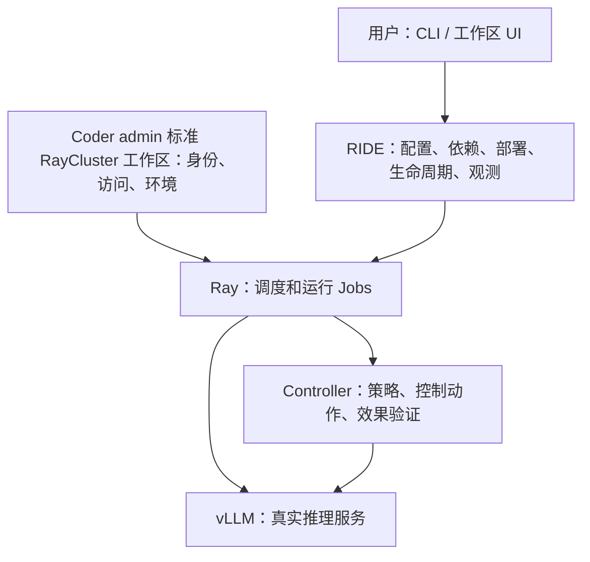

# RIDE 开发与变更契约

状态：毛言粲已在统一 review 后授权继续，2026-10-11。本文描述要求，不证明门禁已实现或验收已通过。

## 1. 目标和系统边界

RIDE 是独立控制平面；Ray 是执行底座；Controller 是被部署的策略进程；vLLM 是推理服务。
目标是在已有基础设施上做增量开发，让安装、部署、管理和验收可重复执行。

RIDE 不替代 Coder、KubeRay、调度器、网关或存储平台。Controller 不创建这些平台资源。
每个工作区运行独立 RIDE；不得建立平台级共享 `/ride/` 服务。管理 API 不必代理推理流量。
Controller type 与 instance 区分；停止 Controller 不得隐式停止外部模型或其他实例。
性能优先，复用成熟策略实现；不得以轻量为目标牺牲性能，或将重写实现称为官方等价。

## 2. 环境与部署约束

本用户当前云上验收使用 9450、Coder **admin**、已有标准 RayCluster 模板。
先查已有合适集群；没有时按明确授权，通过该模板创建一个共享工作区和 RayCluster。
“新开 RayCluster”不得解释为绕过 Coder 直接创建 Kubernetes 对象。
不为 Demo、Controller 或单次实验新建专用模板。所有本轮组件使用同一个集群。
不得在本机启动验证服务或端口转发，不能用本地检查替代云上验收。
上述账号和环境是本用户的执行约束，不得硬编码为 RIDE 框架对所有用户的限制。

提交 Jobs 前必须核对：Coder 登录账号和 owner、工作区 ID、模板 ID/版本、
工作区关联 RayCluster、实际 head、Dashboard、资源归属，以及固定代码和模型版本。
凭 Ray URL、名称中的 myc 或 HTTP 200 不能证明归属。关系缺失或不一致时拒绝提交。
不得擅自检查、停止他人工作区；不得默认删除工作区、模板、PVC 或集群。

安装和部署只通过统一入口；修复必须固化进入口并重新执行，不能靠未记录临时命令救活后报 PASS。
配置保留可重复性，但普通用户按 Controller 名称启动，不强制手写 YAML。
入口不得猜账号、模型路径、集群地址或自动降级为 Mock。

## 3. 变更与 review

每次变更先列出问题、责任层、具体改动、影响资源、验收动作、预期、失败处理和回滚。
实现与文档使用同一契约。修改入口、资源生命周期、部署身份、策略核心、验收门禁、
公共接口或新增基础设施时，先提供可 review 的差异，等待用户 review 后再实施外部变更。
本次用户要求统一 review：本次已授权按契约通过 admin 标准模板创建共享工作区；不授权平台改造。
已批准范围内的常规修复可继续，但不能扩大资源范围、热改运行实验或降低门禁。
如规则冲突，指出具体冲突；不得自行选择方便路径。新指令须明确更新旧规则。

所有变更必须说明“已实现、已执行、未完成”三种状态。推送、发布和真实硬件操作是不同动作。
没有实际证据不得把计划、语法通过、健康检查或窄项脚本 PASS 写为完整交付。

## 4. 标准验收和证据

验收必须覆盖两种 Controller：Demo 的实际限流动作，以及 Request Throttling 的程序语义。
先固定计划与版本，再依次检查身份、安装、真实模型、Controller、异常请求、幂等与冲突、
停止隔离、恢复、管理进程重启接管。性能实验另行固定同输入、同硬件和统计口径。
CPU UT/Mock 是前置检查，端到端验收要求真实 NPU 和 vLLM。

每项保存执行命令、预期、实际观察、退出码、原始日志、Job ID、时间和证据哈希。
状态只使用 PASS / FAIL / BLOCKED / NOT_RUN；缺证据不通过。部分检查通过不能提升为全套通过。
同名同配置重复启动必须不重复提交；配置冲突必须拒绝；不确定提交结果先查账，不能盲重试。
失败先存现场，再修复、固定新版本、独立重跑；不混合不同轮次或改阈值掩盖失败。
清理只针对有完整归属证据的本轮 Jobs，先回收证据；基础设施保留，另行授权才清理。

## 5. 强制门禁及当前缺口

| 门禁 | 必须实现 | 当前状态 |
|---|---|---|
| Coder 与 Ray 关系 | 无正确 owner/模板/关联关系拒绝部署 | 已接入实时身份门禁；真实链路执行待验收 |
| 禁止旁路 | 产品流程不得直接创建平台对象 | 文档约束；自动检查待补 |
| 错误路径测试 | 错账号、非关联集群、错误模板、重复提交须失败 | 9 项身份正反例已在云上通过；重复提交单独验收 |
| 全套验收 | 异常、语义、接管和硬件证据缺项拒绝总 PASS | 当前入口返回 INCOMPLETE，覆盖待补 |
| 正确路径 | admin 标准工作区一次走完安装部署验收 | 尚未完成 |

全部门禁完成前，不宣称“已防止再次犯错”。历史直接创建的集群属于偏差，不能作为标准部署示例。

Review 重点：责任边界是否正确；工作区和集群创建是否符合既有设施；需要 review 的变更范围；
两个 Controller 的门禁是否足以证明可用；原始证据是否能直接复查。
