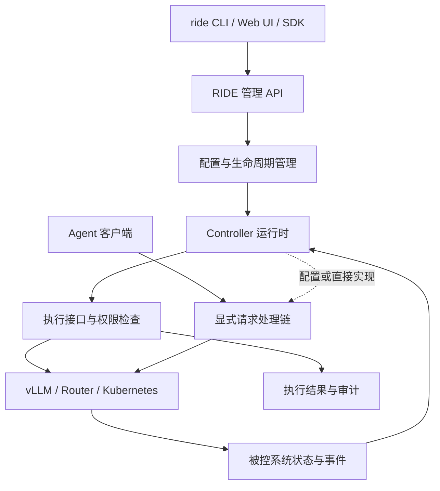

# RIDE：可复用控制平面框架与服务平台规范

状态：设计规范 v0.1，2026-10-10。`ride serve --config`、工作区 UI 和单 controller Ray 生命周期已实现；其余命令及公共控制闭环契约为目标接口。

## 术语与架构边界（以用户控制面定义为准）

定义来源：[大模型推理的控制平面调研和方案选型](https://ocnkis1vvvv6.feishu.cn/docx/BMsZdF2PJoUwuvxJmUecLnHgn2H)，第 1.2、1.3、1.7–1.9 节。

- **RIDE = Control Plane**：统一 Intent、State、Controllers、Actuation 与 Feedback / Reconcile；它不是 Request Throttling 的别名。
- **Request Throttling = Controller**：RIDE 中针对 program 请求节流的一个控制闭环；不得把一个 Router 或 controller 称为完整控制平面。
- **Controller Runtime**：承载触发、执行、生命周期、追踪与故障处理，不定义具体节流策略。当前 `ride.runtime.Runtime` 只实现 Ray job 生命周期和状态探测，是其部分实现。
- **Ray = 执行后端**，**Coder = 工作区、认证和应用代理**，**vLLM = 推理 Data Plane**；它们都不等于 RIDE。
- **Web UI / CLI = 管理入口**：表达配置、查看状态、发起操作；UI 可访问不代表完整控制闭环已经实现。

统一 Controller 编程范式：`Observe → Analyze / Predict → Decide → Actuate → Verify / Reconcile`。Decision 尽量无副作用，外部修改通过 Actuator。Router 的转发属于执行职责，内部节流决策属于 Controller 职责；逻辑分层不强制拆成独立进程。

当前验收仅证明 RIDE 原型能承载 Request Throttling Controller 并管理其 Ray 生命周期。统一 State、Decision / Action、Actuator、Feedback 和跨 Controller 组合尚未完整实现；不能把“启动一个 controller”称为完整 RIDE 架构验收。

## 产品定位

部署边界修正：每个 Coder workspace 独立运行自己的 RIDE 实例，配置、controller、日志、端口和生命周期属于该 workspace。Coder 只提供工作区管理、认证与应用反向代理。不在平台宿主机运行共享 RIDE，不使用平台根路径 /ride/ 作为产品入口。Ray 工作区内由 head 的 Coder Agent 代理本工作区 RIDE 应用端口；Ray Dashboard 与 RIDE 分开。

RIDE 是统一运行、组合与治理 controller 的控制平面。用户通过 `ride` 选择 controller、连接被控系统、查看状态与执行结果。Controller 是 RIDE 的可安装组件；Request Throttling Controller 是第一个接入实例。RIDE 不限定组件必须轻量，不以重新实现上游算法作为接入条件，性能与正确性优先。

例如：用户已经有一个 vLLM 引擎，需要限制同时 reasoning 的 program，同时按缓存局部性选择副本。RIDE 加载请求节流和前缀路由两个 controller，验证它们控制的资源及顺序，启动请求处理链；用户只使用 RIDE 输出的客户端地址。

## 统一命令

```bash
# 验证配置并展示控制权、请求路径和计划，不启动服务
ride validate --config ride.yaml
ride plan --config ride.yaml

# 本机前台启动；不隐式启动或停止外部引擎
ride serve --config ride.yaml

# 便捷选择单个 controller，等价于明确的配置
ride serve --controller request-throttling --backend http://127.0.0.1:8000

# 连接运行中的平台；运行标识、目标和 controller 必须明确
ride status --address http://127.0.0.1:9100
ride controller list --address http://127.0.0.1:9100
ride controller disable request-throttling --address http://127.0.0.1:9100
ride doctor --address http://127.0.0.1:9100
```

`serve` 运行控制平面；`controller` 管理组件；`status` 展示实际运行状态；`doctor` 检查依赖、权限和控制路径。服务化后的 CLI 使用同一管理 API，不另造一套语义。安装、配置、启用、就绪、实际生效分别记录。

## 声明式配置示例

```yaml
apiVersion: ride.hust/v1alpha1
kind: ControlPlane
metadata:
  name: local-serving
management:
  listen: 127.0.0.1:9100
targets:
  - id: engine-1
    type: vllm
    endpoint: http://127.0.0.1:8000
    lifecycleOwner: external
controllers:
  - id: request-throttling
    implementation: request-throttling-controller
    version: "<exact release or commit>"
    enabled: true
    targets: [engine-1]
    config:
      transport: no-keepalive
requestPipeline:
  listen: 127.0.0.1:9000
  stages: [request-throttling]
```

这是 RIDE 自身的待实现配置 schema，不冒充 Plugins 页已支持的 manifest。密钥使用独立 secret 引用，不写入导出配置或日志。启用配置变更必须产生新 revision，记录实际应用结果。

## 系统架构



管理 API 不成为每个请求的强制中转点。Controller 可在请求路径内执行，也可在路径外调谐系统。允许共享进程或独立进程；共享进程不构成权限隔离。部署方可选择本机、容器或 Ray/Kubernetes，controller 的业务契约保持相同。

## Controller 接入契约

每个组件必须交付以下内容：

1. **Descriptor**：稳定 ID、版本、配置 schema、兼容范围、依赖、运行方式、控制资源、权限、上游来源与入口。
2. **Lifecycle**：配置验证、启动、就绪、健康、停止；停止有截止时间和明确的在途请求处理。初始化失败时只清理由本次运行创建的资源。
3. **Observation**：状态/事件来源、时间戳、版本、有效期；过期或缺失观测的行为显式声明。
4. **Control**：动作的目标、作用域、前置条件、超时、幂等方式和结果。拒绝或执行失败不能记录为已生效。
5. **Evidence**：实际加载实现、源码版本、有效配置、控制动作计数、延迟、失败和回退记录。

不要求所有 controller 重写成纯 Decision 函数。已有系统可以由适配组件管理原来的状态、调度及转发；需要公开上述边界。高频动作可以在组件内直接执行，但必须受声明的控制权约束，并可观测。

## 组合、故障与控制权

观测可共享；写控制权按目标、资源和范围分配。两个组件写同一资源时，必须提供经过验证的组合或仲裁规则，否则启动失败。请求处理链的顺序显式配置，禁止依赖安装顺序。

配置采用 desired revision / applied revision；存在差异时显示 Pending 或 Failed，不只显示 enabled。禁用 controller 与停止其进程是不同操作：禁用要撤销控制权，并按契约处理排队和在途请求。故障时旁路、阻断或保持最近有效配置由组件和部署配置共同约定，禁止无记录静默降级。

服务化多副本写控制器必须有租约或 fencing，避免重复执行。管理权限按租户、目标和动作授予；读写 API 分离，所有变更有操作者、revision 和执行结果。远程服务发布前完成认证、授权、审计及故障恢复验收。

## 验收与推广

接入验收分为来源、实际运行身份、行为/故障/回退、端到端性能四层。Request Throttling 接入保持当前官方核心和普通请求旁路；先比较现有入口与 RIDE 入口，再做同硬件、同配置、同输入的 vLLM / ThunderAgent / Our Controller 对照。并发指 workflow/program 并发，卡数单独记录。RIDE 引入的启动、管理和请求路径开销分别测量，不预先声明零开销。

跨 controller 的性能容差不能统一写死。每次在测量前声明适用负载、指标和容差；保存原始日志、统一 CSV、脚本生成的图及负结果。

## 实施阶段

1. 本机 RIDE CLI + 单 controller 生命周期；接入当前已验收实现，测新旧入口等价性。
2. 双 controller 显式组合；验证控制冲突、单组件故障和禁用。
3. 管理 API / SDK；本机 CLI 与远程客户端共用接口。
4. 服务化部署；增加认证、租户权限、审计、租约、持久化与恢复。
5. Web UI 与 controller 目录；显示兼容性、实际生效与分层证据。

对外统一称 RIDE，命令统一 `ride`。本规范不创建 PyPI 包，也不宣称 `ride` 包名或商标已注册。Controller 安装包和仓库独立演进，RIDE 不强制合并其代码。

## 当前依据

- [Plugins 架构](https://vllm-hust.sage.org.ai/plugins.html)：外部控制面与引擎插件角色分开，外部服务生命周期由部署方拥有。
- 当前入口：`src/thunderagent_controller_mod/__main__.py`，独立服务、显式后端/启用/禁用/传输参数。
- 当前交付：`docs/CONTROLLER_MIGRATION_DELIVERY_20261010.md`；性能范围及失败记录以实验文档为准。
