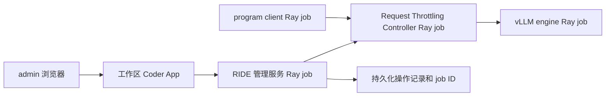

> 当前部署边界：[复用已有 RayCluster](DEPLOYMENT_POLICY.md)。RIDE 只管理自己的 Jobs；不得按验收新建 Coder 模板／工作区。CPU 测试不替代真实 NPU 端到端验收。

> 本文涉及旧环境、旧入口或临时资源的内容为历史记录／早期规划，不是当前部署操作指南。已删除资源不得据此重建。

# RIDE 工作区端到端验收 · 2026-10-10

## 目标与边界

RIDE 是 Control Plane；Request Throttling 是其中一个 Controller。本轮是控制平面原型接入单 Controller 的部署与生命周期验收，不是完整 Control Plane 公共闭环验收。

每个 Coder workspace 独立运行 RIDE，通过自己的 Coder App 查看、启动和停止 controller。Coder 提供认证和代理，Ray 执行 controller，模型引擎是独立 job。

## 当前真实部署

- workspace: `admin/ride-e2e-myc`，专用模板 `ride-ray-acceptance`，head-only，一张 NPU，4 CPU / 32 GiB。
- Web UI: https://coder.sage.org.ai:9450/@admin/ride-e2e-myc.main/apps/ride/ ，owner-only。admin 认证外网 HTTP 已返回 200；浏览器实际 UI 操作通过 SSH 到同一服务验收。当前 user 浏览器登录需换 admin，未扩大共享权限。
- RayCluster: `ray-admin-ride-e2e-myc`。head 从 Kubernetes 动态读取；不得沿用本文 IP 作为新部署配置。
- 管理服务、controller、engine、client 为独立 Ray jobs。
- 实际 controller: `ThunderAgent.scheduler.router.MultiBackendRouter`，上游固定 `7ddc861`，运行身份包含 17 文件来源哈希。
- 模型 Qwen2.5-14B-Instruct；KV capacity 154368 tokens；controller transport 显式 no-keepalive。

## 已完成的真机检查

1. 通过 UI 启动 controller，Ray RUNNING、实际后端匹配、引擎健康后才显示就绪。
2. 真实 2 program × 3 轮：6/6 成功、2/2 完成；输入 4125/4765/5405、输出每轮 128；零 token 偏差，逐轮 inherited_history_sha256 与 previous_history_sha256 一致。耗时 103.3894 秒。数据为合成 token 和模拟工具等待的真实模型请求，不是 SWE-bench 正确性验收。
3. 通过 UI 停止 controller：原 job STOPPED；engine job 仍 RUNNING，/health 200。
4. 通过 UI 恢复：创建新的 controller job，重新就绪；实际 chat 请求恢复成功，prompt 33、completion 2 tokens。
5. 管理服务更新保留同一 state_file，controller 和 engine 无需重启。修正了停止 controller 时错误显示引擎未就绪的 UI 探测问题。

本地原始证据保留 `results/acceptance/`：smoke 原始 rounds/tokens/metrics/summary、smoke-audit.json、status-running.json、workspace-create.log、Coder App HTML 与恢复请求。原始结果不提交公共仓库。

6. 工作区 Coder App 外网控制 API：admin 认证、同源 POST 返回 202、unchanged=true，未重复提交已有 job。

## 尚未宣称通过

- 本轮是部署和生命周期验收，103 秒小样本不是性能收益证据。9443 三方并发扫描独立进行，不能把旧性能数当成 RIDE 本轮收益。
- 当前支持一个内置 controller；通用 plugin discovery、统一 metrics、配置热更新、HA 和跨 workspace 权限隔离仍需实现。
- 管理端口本身无独立认证，部署必须限制在工作区网络并通过 owner-only Coder App 访问。
- stop 会中断该 controller 正在处理的请求；本次 stop 在有限 smoke 完成后执行，不代表已支持优雅 drain。
