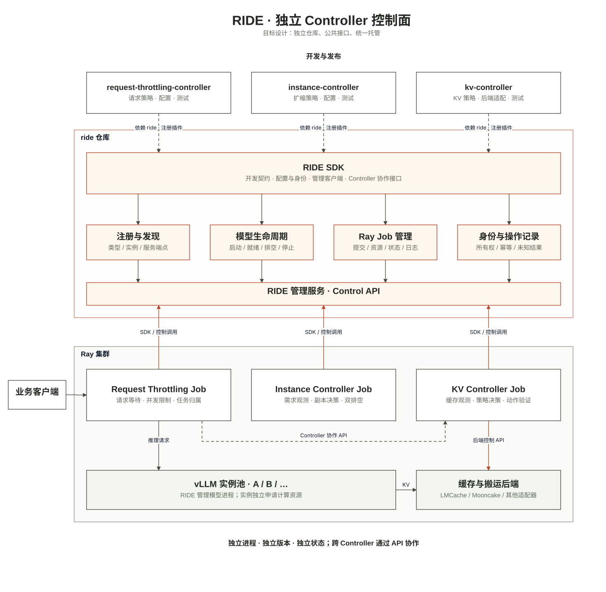

# RIDE 与独立 Controller：统一技术设计

状态：2026-11-05 用户已确认的目标架构；按下方验收逐项实现。图中的目标模块不等于已全部实现。执行顺序与各项目状态唯一记录在 [统一路线图](CONTROLLER_ROADMAP.md)，不在各仓库复制另一份独立计划。

## 1. 要实现什么

每类 Controller 都是独立 Git 仓库、独立 Python 包和独立运行进程，依赖公共 RIDE SDK；RIDE 管理服务把 Controller 和 vLLM 实例托管到已有 Ray 集群。Controller 负责策略，RIDE 负责生命周期，Ray 负责执行。共享开发契约，不共享业务实现或 Python 内存状态。

[编辑图](assets/ride-architecture.drawio) · [PNG](assets/architecture.png) · [结构源文件](assets/architecture.json)。白底、细线、橙色强调，依赖、管理调用和推理数据流按区域分开；后续在该源图上修改。

## 2. 仓库和依赖

| 仓库 | 内容 | 依赖方向 |
|---|---|---|
| ride | SDK、公共协议、CLI、管理服务、Ray 执行适配、模型生命周期 | 不依赖具体 Controller 策略 |
| request-throttling-controller | 原有限流/多轮任务控制、其 RIDE 适配与测试 | 依赖 ride；不依赖其他 Controller 包 |
| instance-controller | 副本数策略、启动/就绪/排空/停止的协调循环 | 依赖 ride；通过 HTTP 调用请求/KV Controller |
| kv-controller | KV 策略、观测与动作验证；底层适配器 | 依赖 ride；按需依赖 LMCache、Mooncake 等 |
| 其他 Controller | 需要独立发布/运行的策略各自建仓 | 遵循相同契约，不统一塞回合集 |

旧 ride-cooperative-controllers 保留历史原件与已验证实现，作为迁移来源和集成证据，不作为未来所有策略的发布单元。迁移记录源提交/文件 SHA、必要差异和独立测试，不能把拷贝后的软件通过当实机通过。

## 3. RIDE 是库，也是管理服务

`import ride.sdk` 只加载轻量协议和客户端，不导入 Ray/vLLM/缓存 SDK，不启动服务、不提交作业。一个工作区使用明确地址和状态目录的 RIDE 管理服务；禁止每个 Controller import 后各自创建 Runtime。RIDE 不是平台级共享管理员服务。

管理端通过 `ride.controllers` entry point 发现轻量适配器。每个适配器提供 `command(spec)` 与 `probe(spec)`；重依赖只在对应 Controller Job 环境加载。包版本、来源、配置 SHA 与运行环境固定，Controller type 和运行 instance 分开。公共协议版本独立声明。

SDK 提供：模型管理客户端、Controller 发现/调用客户端、身份/配置契约、操作结果、持久化动作记录等公共工具。先提供实际需要的最小接口，不引入大而全的 Controller 基类或插件自动下载器。

## 4. 数据流与控制流

业务：客户端 → Request Throttling Controller → vLLM。管理服务不转发每次推理。调用方显式提供多轮任务身份，任务结束显式 release；工具等待不等于任务结束。

控制：Controller 观测 → 自己决策 → SDK 调用 RIDE 或其他 Controller 的 API → 执行方返回动作身份与状态 → 调用方验证实际结果。Controller 不直接创建 RayCluster、Coder workspace 或平台存储。

缓存数据由现有引擎/后端搬运，KV Controller 不自行实现传输引擎。接口要表达能力和完成语义，不能把普通健康、登记或“任务已受理”当真实完成。

## 5. 状态与动作的唯一管理者

| 状态/动作 | 唯一管理者 |
|---|---|
| 请求槽位、任务归属、请求排空 | Request Throttling Controller |
| 缓存策略、KV 动作及排空状态 | KV Controller / 对应后端适配器 |
| 期望副本数、扩缩协调 | Instance Controller |
| 实际 Controller/model Job 身份、启停、日志 | RIDE 管理服务 |
| 实际资源调度与进程执行 | Ray；平台资源由已有平台管理 |

停止模型必须经过请求排空和 KV 动作排空，并核准确 Job 身份。启动必须带本次创建操作身份和原作业身份条件，在管理端同一临界区校验，不能仅先 GET 再 POST。已完成操作返回原结果；提交结果未知不重投。独立仓库不意味着自动具备多副本高可用，首版各 Controller 单写者、独立状态文件。

### 5.1 可替换的模型进程与独立生命周期

运行中请求迁移后，原HTTP前端仍持有客户端连接，不能随原模型Worker一起停止。模型后端通过独立包的`ride.model_services`入口注册`command(spec)`和`probe(spec)`；RIDE仍是唯一Job提交者。现有`vllm`与`mock-vllm`保持原路径，未知或重复后端在提交前拒绝，不猜测引擎类型。插件只返回一个前台命令和就绪观察，不自行提交子Job或创建平台资源。

前端与Worker各用一个明确的`model_services`实例、配置和原生Job身份，复用现有有条件启停、UNKNOWN保留、持久状态和管理接管。前端为CPU进程，Worker按配置申请加速器；Instance的副本池只列Worker。停止Worker不级联停止前端，管理重启不重建任一已有Job。具体引擎连接、输出转发和迁移协议由模型适配包实现，不进入RIDE核心或其他Controller仓库。

插件必须先验证冻结配置及实例/端点绑定，且`probe`仅在已记录Job为RUNNING时执行；明确的`model_ready=true`才就绪，协议/身份错误与失联均不能退回普通HTTP健康。该接口不自行证明前端和Worker配对正确，配对、输出顺序、迁移后的取消路由及真实Worker回收必须由对应后端另外验收。首个使用者为Llumnix请求迁移适配；原生传输门禁、完整迁移及性能仍未通过。

## 6. 统一接口最小集合

- 开发/部署：固定配置、独立进程入口、适配器注册、协议版本。
- 观察：health、identity、status、capabilities、标准输出日志；控制进程健康与底层功能就绪分开。
- 生命周期：启动条件、操作 ID、实际 Job ID、查询、带 expected_job_id 的停止。
- 协作：按身份发现服务端点；只通过有版本的 API 调用，不 import 对方策略代码。
- KV：capabilities、连续覆盖 lookup、保源完成 copy、health。未知观察不填 0；不支持动作提前拒绝；提交未知保留记录。

旧接口兼容；新安全能力通过 capability 显式协商。业务请求不设 timeout、不自动重试。管理探测和整体资源期限另计，不能混成业务 SLO。

## 7. 当前实现与边界

当前版本、测试、实机状态与下一项只在统一路线图维护，避免本文重复过期计数。三个独立包已通过公共SDK/API接入真实Ray和模型。限流层新增预声明模型池的可用性管理，原版调度核心逐文件SHA固定。缩容区分启动、服务、排空、停止状态；停止中的作业仍占资源上限，剩余Ready副本达到下限后才排空或停止。

真实生成、多轮输出继承、稳定扩缩及KV/Instance进程隔离已获有限功能验证，不证明任务答案正确率或性能改善。原生vLLM后端只读，不支持外部KV复制；r19失败未解决。限流层采用保守全局排空，不能恢复非空原版Router运行态。管理接管及只读观测故障恢复仍按路线图验收，不承诺多副本高可用。

## 8. 验收顺序

先统一协议与失败回归 → 独立安装/注册/发现/启停/重启状态 → 两类 Controller 的跨进程协作 → 真模型动作与输出正确 → 完整批次强基线收益。每项按实际证据核销。CPU/Mock 不充当 NPU；固定 RayCluster 下停止模型 Job 不等于释放平台申请卡时。

B1/SWE 线保持用户要求的暂停；其他研究线和共享平台工作不自动并入。当前文档/软件开发不授权新平台变更。资源实验沿已明确的具体范围，重新冻结身份与截止，结束归档清理。

## 9. 2026-11-06 审查后的有限正确性契约

本节描述新增软件行为，不将旧NPU回执升级为新版本验收。RIDE0.3.3、Instance0.1.5、KV0.1.3、Request0.1.1须作为兼容组合验证。

- RIDE在加载状态、自动启动或提交Job之前，持有规范化状态路径的独占文件锁；第二管理进程拒绝启动。`Runtime.close()`仅释放管理所有权，不停止Jobs；同一文件系统上的进程互斥不等于分布式租约或HA。状态写入先fsync临时文件，再原子替换并fsync目录；真实断电耐久性尚未实测。
- 停止接口省略`expected_job_id`保留旧兼容语义；显式出现该字段时，必须为非空字符串并匹配当前Job。自动控制必须使用有条件接口。
- Request与KV对同一Job遵循`active → draining → inactive`。普通activate不能取消drain；移除后的Job身份保留为退役记录，迟到命令不能复活。新的Job只能在旧绑定已移除后激活。本轮不提供取消排空/恢复旧Job接口。
- KV的activate/drain/remove调用均要求`job_id`；copy要求`source_job_id`和`target_job_id`，prepare要求`target_job_id`。检查与状态修改在同一Journal锁/事务边界内；回执带精确Job。底层KV实例的身份仍由固定后端配置声明，本轮没有增加引擎身份认证或真实KV复制能力。
- Instance启动模型前检查管理端`single_writer`、Request的`monotonic_drain`、KV的`replica_job_binding`与`monotonic_drain`。旧版缺能力时拒绝执行；激活、排空和移除回执须匹配准确Job。停止确认后移除Request和KV绑定，重复移除同一退役Job可幂等返回。
- `Journal.execute(..., on_complete=...)`把动作完成回执与对应业务状态放入同一次SQLite事务。事务失败保持UNKNOWN，不重做外部动作。KV仅用已提交、覆盖核验完成的结果修复旧版二次记账窗口；UNKNOWN不能自动置成功。

升级前先保全旧配置与状态。不得热替换运行中的旧组合；确认各Controller终态后使用匹配版本与新冻结配置。旧版没有完整Job绑定的排空状态不猜测恢复；无法核清时保留旧状态并另行资格化，不通过清空数据库消除UNKNOWN。回退只停止新Controller，保留模型及全部状态/日志；不能让旧版本直接接管新增状态语义。

以上0.3.3组合是一条有界生命周期协议。当时尚无统一对象schema和状态版本/CAS；0.3.4的新增契约见第10节。跨服务一致快照、动作补偿和真正UNKNOWN结果的显式核销仍开放，不据能力标志宣称全套控制面已完成。

## 10. 对象观察和本地状态动作契约

RIDE0.3.4、Instance0.1.6、KV0.1.4、Request0.1.2增加首条实际使用的版本化调用链。通用schema可以描述Service、InstancePool、Instance、ResourceBinding、RuntimeState、Program、KVState；本阶段实际发布的对象视图仅为Request/KV各自负责的Instance成员状态，不称其他控制域已实现。

对象观察`ride.object/v1`包含`object={kind,name,uid}`、`owner_id`、`owner_uid`、`resource_version`、`observed_at`、`state`和`observations`。Instance的uid为当前绑定的Job，未绑定时为null；name只定位预声明的逻辑副本。Request和KV是两个不同所有者的视图，用name/Job关联，不能比较它们的resource_version。owner_uid标识接收方持久数据库世代，Instance首次绑定后不自动接受其改变；它不是共享token的授权身份。resource_version是接收方持久数据库epoch及该对象计数组成的不透明值；进程重启保持，重建数据库改变。observed_at是采样墙钟，不是分布式时钟证明。

`state`中的成员phase/job_id由对象版本覆盖。`observations`中的drained、pending/inflight等为本次采样，独立变化；接收方执行remove时必须重新检查，不把观察字段误当冻结状态。旧的成员变更入口也推进同一对象版本；普通业务记账和其他对象变化不使本对象的成员版本无效。

- GET `/control/replicas/{name}`：读取该接收方负责的Instance状态与当前排空观察。
- POST `/control/action`：提交`ride.action/v1`，包含唯一operation_id、actor_id、预期owner_id/owner_uid、target对象、expected_resource_version、action和parameters。
- GET `/control/actions/{operation_id}`：查询已提交的原操作回执；不存在返回404，不推断操作可重投。

服务端只接受activate/drain/remove三种本地成员状态转换，不在SQLite事务里调用Ray、引擎或搬运器。先查相同操作ID的已提交记录：请求逐字规范化相同则返回原回执，内容不同则拒绝。新操作在同一事务核对owner_id/owner_uid、对象UID和版本、执行本地转换、更新版本并记录`ride.action-result/v1`。过期或错误前置条件不产生状态变化和成功回执。回执带请求SHA、原target和变化后的对象/版本；SDK验证身份与请求SHA。actor_id用于追踪，不等于基于身份的访问授权；现有peer token和可信网络边界不因此升级。

Instance将每个发出的状态动作及完整envelope先持久化，再进行一次POST。回复丢失后只查询原回执，核对请求SHA后继续；404/查不到不能当作未执行，保持UNKNOWN且不重投。版本冲突停止该动作，不自动换版本重试。首次drain回执只证明本地动作完成；后续用GET重新观察排空进展，不反复发drain，也不把缓存的drained=false当永恒状态。真正UNKNOWN结果的人工/外部证据核销仍需后续接口。

共享SDK提供make_action、validate_snapshot、verify_action_result、StateClient及Journal的observe_object/apply_action/read_action。`ride.sdk.testing.StatePeerFixture`仅供CPU软件验收，复用真实对象事务但执行为fixture，不能用于生产或充当模型性能证据。

这不是跨服务原子事务、一致快照或所有策略的冲突仲裁。RIDE模型启动/停止仍使用既有精确Job条件及独立效果账本；KV字节传输仍使用既有后端接口。本轮旧/新能力必须匹配，Instance缺少versioned_state_actions时拒绝自动执行，不热混旧组件。实际Coder资格和NPU验证另记。
