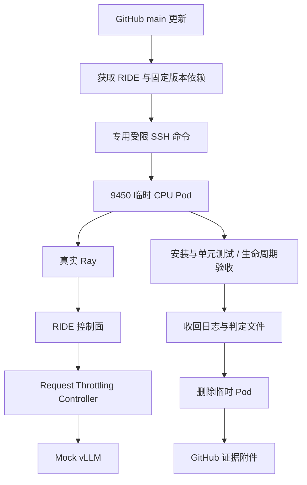

> 当前部署边界：[复用已有 RayCluster](../reference/DEPLOYMENT_POLICY.md)。RIDE 只管理自己的 Jobs；不得按验收新建 Coder 模板／工作区。CPU 测试不替代真实 NPU 端到端验收。

> 本文涉及旧环境、旧入口或临时资源的内容为历史记录／早期规划，不是当前部署操作指南。已删除资源不得据此重建。

# 临时 CPU 云端验收

RIDE 是控制面，Request Throttling 是 Controller，Ray 是执行底座。本流程用真实 Ray、RIDE 和 Controller，只有模型服务使用明确标记的 Mock vLLM。所有安装、测试和执行发生在 9450 云上，GitHub 执行器只取代码、触发和接收证据。

## 运行与资源边界

云端运行器建立独立 `ride-cpu-ci-myc-*` Pod；请求 1 CPU、2 GiB，限制 4 CPU、8 GiB。Kubernetes 没有 GPU/NPU 请求、设备挂载或 ServiceAccount Token。Ray 显式 `num-gpus=0`，每个应用作业零加速器资源。Pod 最长运行 20 分钟，SSH 操作有超时，正常及异常路径先取证再删除这个精确 Pod。没有长期验收工作区，也不会修改用户的模型服务。

GitHub CPU workflow 在 main 更新或手动运行时触发。GitHub 执行器下载固定依赖后，把源文件交给云端固定命令；云端无需连接 GitHub。专用 SSH Key 使用 `restrict` 与固定 command，只允许 `ride-cpu-acceptance`，禁止端口转发、交互终端和其他命令。网关拒绝路径穿越、链接和过大包；仓库源代码在无宿主机挂载的 CPU Pod 内执行，宿主机只运行已安装的固定编排器。

平台运维将固定运行器安装到 `/opt/ride-ci/`，按 `docs/reference/ci-cloud-profile.example.json` 配置云端 `/etc/ride-ci/config.json`，再配置云端三项仓库 Secret：`RIDE_CLOUD_KEY`、`RIDE_CLOUD_HOST`、`RIDE_CLOUD_KNOWN_HOSTS`。实际值不放进仓库。私有 Controller 仓库禁止部署密钥，遵守该策略。云端保存指定提交的只读源码快照，使用逐文件哈希校验后注入临时 Pod；GitHub 不接收个人访问令牌或私有源码快照。当前固定提交为 `cb4c4e5c46875ea7f2a0a8618c54c9bb39989926`，更新依赖须重新部署并校验快照。真机 workflow 仍需显式提供专用执行器及部署记录，不能沿用已删除工作区。

## 判据与证据

先安装构建包，运行 14 项测试；随后启动 Mock 模型和真实 Controller。验证 Ready、依赖一致、幂等启动、Controller 停止不影响模型、恢复、实际模型请求，以及管理进程重启后接管相同作业。产物包含 `tests.log`、`before.json`、`after.json`、`gate.json`、每个 Ray Job 日志、Pod 资源记录和 `cleanup.json`。

初次云端测试已完成 14 tests PASS 和生命周期 PASS；发现 Ray 启动子进程继承执行通道导致归档等待，修复标准输出、错误输出及输入隔离，并再次跑通自动归档和删除。已保存失败轮与修复轮，不能把失败轮的清理描述成自动成功。

Mock 只提供确定性非流式响应，不证明模型质量、真实 token、KV 缓存或性能。浏览器 Web UI、Coder 登录隔离和 Controller 完整 program 语义不在本轮验收范围；继续保持 NOT_RUN，不能把本流程 PASS 说成全部平台或真机性能验收通过。

本地仅编排、编辑和接收证据；运行记录在 `results/disposable-cpu-fixed-20261010/`。GitHub workflow 的结果单独记录，不把手动云端 PASS 当成 Actions PASS。
