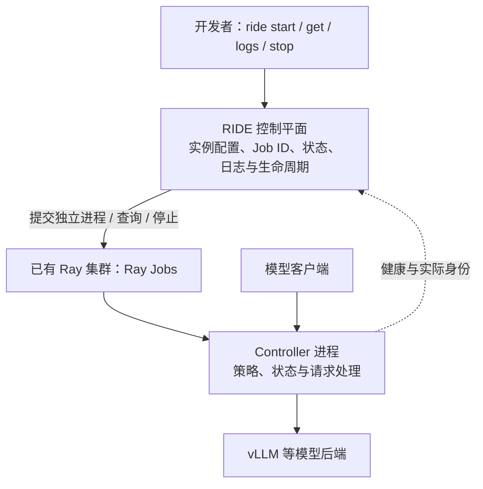

> 当前部署边界：[复用已有 RayCluster](../reference/DEPLOYMENT_POLICY.md)。RIDE 只管理自己的 Jobs；不得按验收新建 Coder 模板／工作区。CPU 测试不替代真实 NPU 端到端验收。

# Controller 开发与 RIDE 接入指南

目标是让开发者实现自己的 Controller，然后用统一命令将独立进程部署到已有 Ray。
RIDE 是控制平面；Controller 是策略与服务实现；Ray 是进程执行底座。
本指南对应SDK 0.3.6源码、协议版本1；新版本真实Ray/NPU验收仍须核路线图。接口说明见[公共SDK](SDK.md)，当前实机及未验收范围见[跨仓库路线图](../architecture/CONTROLLER_ROADMAP.md)。不把协议版本、插件发现或健康检查当作策略正确性证明。

## 1. 系统责任与运行路径



RIDE 负责配置校验、Ray Job 提交、资源与运行环境传递、实例持久化、重复启动保护、
仅停止自己记录的 Job、状态与日志查询。它不实现 Controller 的调度策略。
Controller 负责业务策略、业务状态、后端通信及自己的 HTTP 服务；不应自行创建或停止 Ray 集群。
图中的请求转发适用于 Request Throttling；其他 Controller 可以不在请求路径上，接入时需另定义其可观测接口。
Ray 已存在，由部署环境提供。Coder 管理工作区及访问入口，不承担 Controller 策略。

## 2. 开发一个独立 Controller 进程

Controller 使用独立 Python 包，提供可重复启动的进程入口，例如：

```sh
python -m your_controller --backend http://model-host:8000 --listen 0.0.0.0:9011
```

配置必须显式传入。不要在包导入时启动服务，也不要依赖 RIDE 工作目录中的隐藏状态。
将依赖版本、来源与兼容范围写入 Controller 自己的包配置和文档。
进程日志写到标准输出与标准错误，才能通过 `ride logs` 获取。
后台线程和连接应随进程退出释放；当前 `ride stop` 是 Ray Job 停止，不承诺 graceful drain。

新的独立Controller优先使用公共`ride.sdk.PythonControllerAdapter`，提供下列进程接口：

| 接口 | 当前读取方式与用途 |
|---|---|
| `GET /health` | HTTP 200且JSON `status=ok`；Controller自己定义是否已具备服务条件 |
| `GET /identity` | JSON包含`id`、`role`、`configuration_sha256`、`protocol_version`；公共适配器按冻结配置逐项核验 |
| `GET /status` | JSON，返回本Controller可观察的状态；字段由公开API约定，不伪造其他策略的状态 |
| 标准输出 / 标准错误 | Ray Job 日志 |

配置采用`ride.controller/v1`，使用绝对配置路径、配置SHA和独立状态文件。适配器构造命令前检查配置与实例id/endpoint一致；运行进程再次核配置SHA。公共适配器的探测有独立2秒运维期限，不把它用于业务请求。它不校验算法效果，也不自动保证源码版本；来源文件、实际加载实现及SHA仍需验收。

内置旧`request-throttling`类型保留`/migration-identity`、`/programs`专用探测，属于兼容入口。新`request-throttling-managed`、`kv-control`、`instance-scaling`使用公共适配器，独立安装、独立发布；其他Controller无需伪造`programs`或`scheduling_enabled`。
健康、进程运行与策略有效是三个不同结论：健康检查不能证明策略正确或性能收益。

## 3. 接入 RIDE：独立包注册适配器

现在支持 Python entry point `ride.controllers`。独立包注册一个适配器，RIDE 自动发现。
参考可运行模板：[ride-controller-demo](https://github.com/vLLM-HUST/ride-controller-demo)。

```toml
[project.entry-points."ride.controllers"]
demo = "ride_controller_demo.adapter:Adapter"
```

适配器提供两个静态方法：`command(spec) -> str` 校验配置并构造进程命令，
`probe(spec) -> dict` 返回 `controller_ready` 布尔值及可选 health/identity/status。
遵循上述公共协议时，可直接继承共享适配器；策略及进程实现仍在自己的包中：

```python
from ride.sdk import PythonControllerAdapter

class Adapter(PythonControllerAdapter):
    module = "your_controller"  # 本包的 python -m 入口
    role = "your-role"          # 与本包冻结配置的role一致
```

进程入口接受`--configuration`和`--configuration-sha256`，通过`load_configuration`读取；该函数只验证配置，不启动服务。`RideClient`用于模型管理，`PeerClient`用于其他Controller公开API；禁止import其他策略包的内部实现。实际独立包示例：`instance_controller.adapter`、`kv_controller.adapter`。
Ray 生命周期、Job ID、日志和持久化由 RIDE 统一管理；新类型不修改这些核心代码。
管理环境和执行节点均需安装包；安装后重启管理进程以使用更新版本。
重复注册同名类型会拒绝；内置 request-throttling 类型保留现有兼容路径，不允许覆盖。
当前通用 CLI 提供 endpoint/port/runtime-env/resources 等配置；新增专用参数可通过
JSON `--config` 传递。公共SDK已提供配置、适配器、客户端和独立SQLite Journal；客户端核协议和服务端能力，不静默降级。它不提供通用策略算法、跨管理副本一致性或插件进程的安全隔离；第三方插件须按部署环境的信任边界安装。

接入完成后的统一命令形式：

```sh
ride start --ray-address http://ray-head:8265
ride start controller <已注册类型> --name <实例名称> <该类型配置参数>
ride get controller
ride describe controller <实例名称>
ride logs controller <实例名称>
ride stop controller <实例名称>
ride start controller <实例名称>
```

组件显示名使用 `display_name`，例如 `Instance Autoscaling Controller`；实例标识使用 `instance-autoscaling-controller`。工作区范围放在部署配置中，不把日期、端口或随机字符串塞进显示名。同一组件恢复后名称不变，新的 Ray Submission ID 以 `execution-2` 明确执行次数。

Ray 部署会通过 `python -m ride.ray_job` 注册原生 driver，再运行适配器产生的前台命令。Controller 包仍可独立运行；local 部署不经过此入口。状态中的 `submission_id` 用于 Ray Jobs 查询/停止，`ray_job_id` 用于关联 Ray Core；历史字段 `job_id` 保留 Submission ID 的兼容语义。原生 ID 尚未产生或读取失败时不伪造值。前台入口通过 `exec` 去掉额外 shell，停止信号转发后等待直接子进程；平台容器的 PID 1 负责回收孤儿后代。两层分别验收，不能用 Job 已停止代替进程已消失。普通 HTTP 服务没有自动产生业务 Ray Actors/Tasks，不能把 JobSupervisor 当作 Controller 的业务 Actor。

类型描述实现，名称描述运行实例。同名配置冲突会拒绝，修改配置需使用新实例名。
Controller 包必须可从 Ray 执行环境导入；可预装到执行节点，或提供 `--runtime-env`。
管理环境与执行环境使用同一冻结版本；配置文件在两端路径和SHA必须一致。若使用部署payload，沿[标准安装部署入口](INSTALL_AND_DEPLOY.md)传送和读回，不以本机import通过代替实际镜像检查。
用 `--num-cpus`、`--num-gpus`、`--resources` 明确声明资源。
服务 endpoint 必须对应实际执行节点和监听端口；当前 RIDE 不自动分配端口或提供负载均衡。
不同节点之间不能用 localhost 作为彼此的服务地址。

## 4. 每个 Controller 的接入验收

先在 CPU 云端使用 Mock 后端验证平台流程，再按需要验证真实模型与硬件。
Mock 只替代模型组件，RIDE、Ray 和 Controller 应真实运行。

| 验收层 | 必须给出的证据 |
|---|---|
| 打包与配置 | 独立安装、入口启动、缺失或错误参数被拒绝 |
| 平台生命周期 | Ray Job ID、RUNNING 与 Ready、日志、重复启动不重复提交、停止隔离、恢复 |
| 实际运行身份 | 版本、配置、加载实现与来源；迁移代码增加来源哈希核对 |
| Controller 语义 | 本类型策略的成功、失败、开关与普通请求隔离用例 |
| 硬件与性能 | 同输入同配置的基线与 Controller 对照，原始日志、错误数及结果口径 |

现有 `ride verify` 提供 Request Throttling 的平台验收起点：

```sh
ride verify --controller throttle-main --model-service model-main \
  --model <served-model-name> --lifecycle --output acceptance.json
```

它不是适用于所有 Controller 的完整验收器。新类型需实现自己的验收判据并接入自动测试。
未执行项保留 `NOT_RUN`；不得把平台 PASS 写成语义或性能 PASS。
验收应在隔离、临时、自己拥有的云端环境运行；先保存原始证据，再清理。

源码入口：[命令](../../src/ride/__main__.py)、[类型映射](../../src/ride/registry.py)、
[Ray 生命周期与探测](../../src/ride/runtime.py)、[验收契约](../reference/ACCEPTANCE_CONTRACT.md)。
已有类型的操作步骤见 [CLI quickstart](CLI_QUICKSTART.md)。


### 在 Ray UI 中理解实例扩缩

Jobs 页按以下完整组件名查看。`RUNNING` 表示进程存活；模型可转发还要核 RIDE 的 `ready` 和真实请求。正常停止后的旧执行保留为 `STOPPED`，恢复产生下一次执行及新的原生 Job ID。

| 组件 | 职责 | 应查看的证据 |
| --- | --- | --- |
| RIDE Control Plane | 托管独立 Controller 与模型 Job，提供生命周期 API | 管理日志、原生 Job ID、组件状态；恢复后其他组件 Job ID 保持不变 |
| Instance Autoscaling Controller | 周期观测、策略决策、调用 RIDE 扩缩，并协调请求与 KV 排空 | `instance_tick` 的观测时间、目标副本、动作和原因；随后对应模型 Job 出现或停止 |
| Request Throttling Controller | 客户端到模型之间的限流与路由 | 逐请求路由、排队、在途请求和任务释放；新增模型实际承接请求 |
| Key Value Cache Controller | 管理已声明 KV 后端及其排空状态 | 后端能力和动作回执；Controller Ready 不代表后端物理复制已验收 |
| Inference Model Replica 1 / 2 / … | 运行真实 vLLM 实例 | 模型启动日志、引擎 Ready、实际生成指标；停止后驱动和子进程消失 |
| Instance Capacity Calibration | 在固定模型上发送容量标定请求 | 实际输入/输出 token、延迟和批次结果；它不是扩缩策略或收益实验 |

这些组件目前是前台进程形式的 Ray Jobs。`JobSupervisor` 是 Ray 的内部托管 Actor，不能解释为业务 Controller Actor；没有提交业务 Ray Tasks 时，Tasks 数量为零是正常现象。Ray UI 负责执行身份、状态和日志，业务指标还需结合 Controller 状态接口与 vLLM metrics。证明一次扩缩要串起同一时间线：策略决策 → RIDE 条件操作及回执 → 精确模型 Job → 新模型真实请求或旧模型排空 → 进程及资源释放。只有创建 Job 或看到两条 RUNNING 记录不够。
