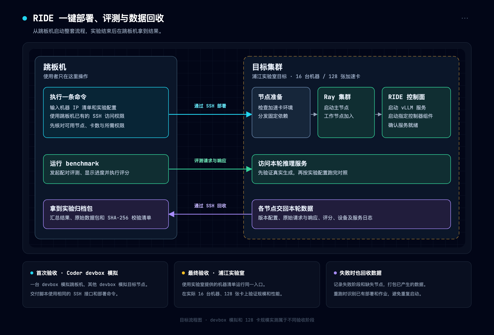

# 从指定机器部署完整 RIDE 服务

状态：2026-11-06，固定提交的双 devbox、双 TP1 功能链已完成 9 次真实生成，
含请求等待/恢复、管理接管和停止隔离。冷启动使用 30ec6a4，管理重启入口使用
3a4adde；随后合入上游 0.3.3 安全修复的开发版通过 103 项软件检查，尚未重新
执行 NPU 验收。Linux 软件 CI 的 103 项、CLI/构建及轻量 SDK 检查也通过；验证清单已按组织规范迁存 benchmark，原件哈希保留。短证据见[验证清单](https://github.com/vLLM-HUST/vllm-hust-benchmark/blob/427c452767d6f7a820da96f4de70dcca786198d8/reports/ride-control-plane-20261106/source/evidence/machine-deployment-20261106/summary.json)。
0.3.4 合并候选包含公共对象和外部模型插件。当时通过 118 项本地软件测试及 CLI/构建检查，后续 NPU 验收见下文。
入口自身的 PASS 只表示部署就绪检查通过，不证明真实推理、Controller 动作或性能收益。
本功能在 RIDE 实现；gennova-d 后续消费，不复制部署器。

## 浦江实验室交付目标



使用者在跳板机执行一条命令，输入已授权的机器清单和实验配置。跳板机通过 SSH
检查节点、安装固定依赖、启动 Ray 和 RIDE、部署 vLLM 与指定控制器，然后运行评测，
收回各节点本轮的原始请求与响应、评分、配置和日志，生成结果包及 SHA-256 校验清单。
失败时保留已采集的数据并报告缺失节点。

小规模验收使用独立 devbox 模拟跳板机和目标节点。Coder 只用于提供容器，部署和评测
入口使用与目标环境相同的 SSH 与服务地址。浦江实验室 16 台机器、128 张卡的规模验收
在实际集群执行。


### 干净环境部署验收

验证拓扑包含 1 台 CPU 跳板机，以及机器清单中指定数量的 NPU 节点。每个测试
devbox 独占一张加速卡。Coder 用于创建这些环境，部署入口在跳板机上通过原生 SSH
运行。节点以干净 Ubuntu 22.04 为起点。宿主机提供加速卡、内核驱动及设备访问。
脚本安装用户态软件，并拒绝在已有 Ray 或指定 CANN 工具链的目标机器上覆盖启动。

使用团队准备过的[机器清单示例](machines-clean.example.json)，填写实际 IP、每台的卡数、
CPU 数、SSH 文件路径及发布包地址，在跳板机运行一条命令：

```bash
bash scripts/one-click.sh machines-clean inventory.json results/pujiang
```

清单第一台机器运行 Ray 主节点及 RIDE 管理进程，每台目标机器启动一个 vLLM
副本，副本内张量并行度取该机器所填卡数。SSH 使用已核验的主机公钥，目标节点使用
专用的 root SSH 账号。跳板机需能安装 Ubuntu 软件包，目标节点之间需允许 Ray 通信。
用 `worker_work_parent` 指定存放安装包、解压临时文件和模型权重的工作目录。还需在
`installers` 配置里指定空间充足、符合安装器权限要求的 CANN 安装路径，并把对应的
环境脚本填入 `environment_scripts`。脚本先安装清单第一台机器并核验设备数量，
通过后并行安装其他机器。

示例清单对应浦江目标规模，共 16 台、每台 8 卡。通过 9443 模拟时，按实际独占
设备数填写节点和卡数。

跳板机启动前可使用 `python3 scripts/clean_machine_deployment.py --check inventory.json`
做不联网的清单校验。在完整节点尚未分配时，可将 `--jump-only` 加到一键命令末尾，
独立验证跳板机依赖、模型 tokenizer 以及 SWE-smith 回放工具。

#### 发布包准备

发布维护者为每个包填入跳板机可访问的地址和 SHA-256。跳板机下载一次，再通过
SSH 把软件和权重发给各节点，目标节点可离线安装。包地址支持内网 HTTP、HTTPS
和跳板机本地的 `file://`。操作人收到已填好的清单后运行上面的一条命令。

| 清单里的包 | 内容 |
| --- | --- |
| `python-runtime` | 与机器架构一致的独立 Python 安装包，含 `python/bin/python3`。可使用 [Python Build Standalone install_only 发行包](https://github.com/astral-sh/python-build-standalone/blob/main/docs/distributions.rst#install-only-archive) |
| `jump-wheelhouse` | RIDE、Ray Dashboard、SWE-smith 回放所需的 Controller 依赖及 Transformers wheel |
| `worker-debs` | 与目标 Ubuntu 版本、架构匹配的离线系统依赖包，tar 根目录是完整的 `.deb` 文件，包括 Python 3、OpenSSH 客户端、rsync、procps、iproute2 及 CANN 所需系统库。SSH 服务由目标机器交付 |
| `worker-wheelhouse` | RIDE、Ray Dashboard、与 CANN 及 Python 匹配的 PyTorch、torch_npu、vLLM 和 vLLM Ascend，以及实际的 Request Throttling Controller 和依赖 |
| `installers` 指定的包 | 实验室批准的 CANN 工具链、内核算子等用户态安装包及该版本的安装参数，按清单顺序安装 |
| `model` 和 `tokenizer` | 模型文件及同版本分词器的 tar 包。模型包直接包含 `config.json`，分词器包直接包含 `tokenizer_config.json`，保存实际文件 |
| `swe-smith` | 固定版本的回放代码和完整输入批次 |

准备冻结回放包与带校验值的 wheel 包：

```bash
python3 scripts/package_clean_machine_assets.py swe-smith CONTROLLER_CHECKOUT COMMIT WORKLOAD_DIR swe-smith.tar.gz
python3 scripts/package_clean_machine_assets.py wheelhouse RESOLVED_JUMP_WHEELS jump-wheelhouse.tar.gz
python3 scripts/package_clean_machine_assets.py wheelhouse RESOLVED_WORKER_WHEELS worker-wheelhouse.tar.gz
```

结果目录保存集群节点清单、回放汇总、逐轮记录和各机器的日志。安装中止时，查看
`results/pujiang.setup/bootstrap-evidence.tar.gz`。完整运行时，查看
`results/pujiang.tar.gz`。两类证据都附 SHA-256 清单。部署状态保存在同级
`.setup` 目录。评测结束后，服务保持运行。归档完成后，可通过冻结的部署计划停止本轮作业：

```bash
RIDE_PYTHON="$PWD/results/pujiang.setup/venv/bin/python" \
  bash scripts/one-click.sh machines-stop results/pujiang.setup/deployment.json results/pujiang.setup/state
```

1. 在跳板机下载并安装部署工具。为依赖包、推理引擎、模型权重和评测输入固定来源、
   版本及校验值。
2. 将软件安装到清单中的所有目标节点，记录各节点实际安装版本、SSH 连通性和设备身份。
3. 启动 Ray，核验清单中的所有节点全部加入。通过 RIDE 部署目标 vLLM 服务和
   请求限流控制器，记录模型作业与节点的对应关系。
4. 使用已有 SWE-smith 多轮轨迹回放工具执行冻结的完整批次。续轮使用模型本轮真实输出，
   汇报完成量、失败量、整批耗时和吞吐。评分是回放完成度与性能汇总。
5. 跳板机收回所有目标节点的安装、部署及服务日志，同时保全评测输入、原始请求、
   响应、结果和 SHA-256 校验清单。

9443 实时检查显示最多 8 个独立 NPU 分配。按上述同时在线的 16 节点规格，
验收需 9443 再提供至少 8 个独立 NPU 分配和匹配的 CPU、内存、卷。2026-11-20
已完成 CPU 跳板机的独立安装验收。干净 Ubuntu 镜像缺少拉取 Coder 登录程序的工具，
因此使用容器控制台进入本轮临时跳板机。Ubuntu 软件仓库下载并安装 Python、SSH
客户端、rsync 等工具，PyPI 下载 Ray 2.48.0 及 Dashboard 依赖，RIDE 0.3.4
从校验过的 wheel 安装。验证了 RIDE CLI 与 Ray Dashboard 模块导入。16 个 NPU
节点的安装、集群启动及 SWE-smith 回放仍待实测。新增的 `machines-clean --jump-only`
也已在 9443 的 ARM64 Ubuntu 22.04 验证。它使用带哈希的 wheel 包重新安装依赖、
读取固定的 SWE-smith 输入和回放代码，成功加载 Qwen tokenizer，并生成了可校验的结果包。

### 2026-11-20 单卡冷安装验收进展

在 9443 的干净 Ubuntu 工作区分配了一张 Ascend 910B2。跳板机通过原生 SSH 传送
了实际的系统包、Python wheel、CANN 安装包和模型。系统包恢复使用 Ubuntu 包管理器的
依赖排序，仅启用本地包。独立 Python 环境装入了 vLLM 和控制面依赖。单卡文本资格
配置保留了 NumPy 1.26.4 和兼容的 OpenCV 4.11，原因是所选 Triton Ascend 与 vLLM
上游 OpenCV 要求不兼容。该配置不用于视频功能验收。

CANN 9.1.0 Toolkit 和 910B 算子包在默认路径安装完成。NNAL 写入默认目录时，
约 9.8 GiB 的工作区系统写入层耗尽，日志报告 `No space left on device`。
此前选择的持久目录位于权限为 0700 的 `/root`，也被安装器的父目录权限检查拒绝。
已核实资料中的[安装参数](https://www.hiascend.com/document/detail/en/CANNCommunityEdition/910/softwareinst/instg/instg_0043.html)。
完整验收需要 16 个独占加速卡的目标实例，并给 CANN 提供可写、有足够容量且符合
安装器权限要求的安装路径。该轮未启动 Ray、vLLM 推理、RIDE 服务或 SWE-smith 回放。

### 2026-11-20 小规模验收

9443 提供一个复用的跳板机工作区和两个临时模型工作区。两个模型工作区位于同一台
物理主机，各使用一张独立的 Ascend 910B2。跳板机通过原生 SSH 启动 Ray，部署
RIDE 0.3.4、两个 vLLM 0.23.0 的 Qwen3-0.6B 实例，以及请求限流控制器组件。
容器提供驱动、CANN、引擎和共享模型。在独立 Python 环境中安装了固定版本的 Ray
Dashboard 依赖、RIDE 和控制器。验证覆盖双节点部署、真实请求、评分和数据回收。

冷启动到结果归档用时 5 分 18 秒，从已准备好的跳板机执行入口开始计算。随后使用
`machines-run` 在同一部署上重验，四道 MMLU-Pro 样本分别经两个直连接口和控制器，
每条路径均完成 4 次生成、答对 2 道。额外验证请求在两个副本暂停接收时进入等待，
恢复接收后完成，并收到控制器的释放回执。跳板机生成两个工作区的日志包、原始响应、
评分和 SHA-256 清单。该规模验收使用独立的单卡模型副本，正式集群的物理跨机通信、
多卡模型切分、性能与容量验收需使用浦江实验室的实际配置。

`machines-run` 在跳板机串起部署、评测和归档。使用事先准备好的机器清单、SSH 主机
公钥和固定版本的软件包，从仓库运行：

```bash
bash scripts/one-click.sh machines-run experiment.json results/my-experiment
```

`experiment.json` 使用以下字段。评测命令的最后一个参数由入口追加，值是本轮结果
目录。评测脚本将原始请求、响应和评分写入该目录。示例中的地址和路径需替换为实际值。

```json
{
  "deployment": "/home/operator/ride-run/deployment.json",
  "state_directory": "/home/operator/ride-run/deployment-state",
  "ssh_key": "/home/operator/.ssh/ride",
  "known_hosts": "/home/operator/ride-run/known_hosts",
  "prepare_command": ["bash", "/home/operator/ride-run/prepare-nodes.sh"],
  "benchmark_command": ["python3", "/home/operator/ride-run/benchmark.py"],
  "hosts": [
    {
      "name": "worker-a",
      "destination": "operator@10.0.0.10",
      "paths": ["/home/operator/ride-run/logs"],
      "exclude": ["runtime_env_agent.log"]
    }
  ]
}
```

准备命令可选，用于检查互通和补齐 Ray 启动器所需的节点工具。Ray 配置中的
`setup_commands` 安装各节点的固定版本依赖。评测失败时仍逐台收集可用文件，并以非零
状态退出。跳板机结果目录里的 `status.json` 记录每一步及每台节点的回执，
`SHA256SUMS` 校验原始记录和节点归档，旁边的 `.tar.gz` 是整个结果包。归档路径
仅填写本轮输出。按节点用 `exclude` 排除可能打印凭据的运行环境日志，
并将凭据与私钥留在运行目录。重复运行使用新的结果目录。恢复部署时沿用
已确认的原部署日志，按照下文的失败恢复约定执行。

## 用户入口与责任

安装仓库主干的 `ride-control-plane[ray]` 后，在可访问目标机器及服务地址的操作环境执行：

```bash
bash scripts/one-click.sh machines-validate deployment.json .ride/deployment
bash scripts/one-click.sh machines-up deployment.json .ride/deployment
bash scripts/one-click.sh machines-status deployment.json .ride/deployment
```

等价的已安装入口是 `python -m ride.deployment validate|up|status|stop PLAN DIRECTORY`。
validate 仅检查配置，无 SSH、安装或远端 Job。up 串行执行：
Ray 官方集群启动器（可选）→ 托管 RIDE 管理 Job → 模型启动/就绪 → 独立 Controller
启动/就绪。操作命令退出后，服务仍是独立 Ray Jobs。

部署前用户或平台提供已授权的机器、设备权限、互通网络、持久目录及模型权重。
bootstrap 的 Ray launcher setup_commands 可以安装明确版本依赖；本入口不安装
宿主驱动、不下载猜测的权重、不更改 Coder 模板或使用宿主 Docker socket。
在 Coder 里先核实 owner、工作区 ID、Pod/设备与实际机器身份；名字不是归属证据。

## 配置契约

以下为结构示例，地址、资源、类型和路径必须按实际环境填写，不能直接作为实机计划：

```json
{
  "schema": "ride.deployment/v1",
  "name": "myc-ride-devbox",
  "ray": {"mode": "existing", "address": "http://10.0.0.10:8265"},
  "management": {
    "endpoint": "http://10.0.0.10:19100", "listen": "0.0.0.0:19100",
    "state_file": "/workspace/home/myc-ride-devbox/state.json",
    "resources": {"node:10.0.0.10": 0.001}, "runtime_env": {}
  },
  "model_services": [{
    "id": "model-a", "type": "vllm", "model": "/models/example",
    "endpoint": "http://10.0.0.11:8000", "port": 8000,
    "num_cpus": 2, "num_gpus": 0,
    "resources": {"NPU": 1, "node:10.0.0.11": 0.001},
    "args": ["--tensor-parallel-size", "1"], "runtime_env": {}
  }],
  "controllers": [{
    "id": "throttle-a", "type": "request-throttling-managed",
    "model_service": "model-a", "backend": "http://10.0.0.11:8000",
    "endpoint": "http://10.0.0.10:9000", "port": 9000,
    "configuration": "/persistent/throttle-a.json",
    "configuration_sha256": "REPLACE_WITH_FROZEN_SHA256",
    "resources": {"node:10.0.0.10": 0.001}, "num_gpus": 0
  }],
  "readiness_timeout_seconds": 600
}
```

Controller 的 configuration 内容及 peer token 以独立请求包的当前契约为准；
文件必须分发到管理和执行节点，且 ID、endpoint 和 SHA 相符。Controller 的
runtime_env 必须注入凭据，操作环境也需设置同一 token 变量；不把凭据放在命令行。
各节点安装固定 RIDE/Controller/引擎版本，或在相应 runtime_env 配置固定依赖。
管理 Job 的 working_dir 由入口上传冻结配置；模型和 Controller 使用各自 runtime_env。
管理 Job 必须固定节点，state_file 的父目录在该节点上预先存在且可持久写入。
readiness_timeout_seconds 控制 Ray launcher 和各运维就绪阶段的期限；管理 API 探测也有有限期限，均不是推理业务 timeout。管理服务不可达时，status 仍返回持久操作记录和 UNKNOWN 观测，不把缺测显示成健康。

对于新版独立请求包，使用其 `request-throttling-managed` 类型，并在 spec 指定
`configuration`（所有执行节点及管理节点上相同的绝对路径）和
`configuration_sha256`。按请求包的 `ride.controller/v1` 配置声明允许的模型池。
固定副本部署还需声明模型池激活，例如 plan 顶层增加：

```json
{"model_bindings": [{"controller": "throttle-a", "model_services": ["model-a"],
                      "token_env": "RIDE_CONTROLLER_TOKEN"}]}
```

入口先检查操作环境的 token 变量存在，再启动服务；全部服务就绪后，通过公开
`/control/capabilities` 协商预声明模型池能力，并调用 `/control/activate`。
只激活本次已启动、Ready 且 Job ID 精确匹配的模型，核对 activated/replica/job_id
回执；UNKNOWN 不自动重放。token 值不写进命令行；Controller 环境需使用同一凭据。
这只连接用户明确指定的固定模型池，不实现调度算法或扩缩决策。
固定副本模式的模型由部署器拥有；不能再启动另一个实例 Controller 接管同一批模型。

bootstrap 模式将 ray 改为：

```json
{"mode": "bootstrap", "address": "http://10.0.0.10:8265",
 "cluster_config": "/absolute/path/cluster.json"}
```

cluster.json 使用 Ray 官方 local provider 配置（JSON 同时是合法 YAML）；明确
cluster_name（等于部署 name）、provider.head_ip、provider.worker_ips、auth、
file_mounts、setup_commands 和 Ray 启动命令。配置及依赖需固定，不从浮动 main 安装。
入口调用 `ray up -y --no-restart /absolute/path/cluster.json`，记录配置 SHA。
仅用于本次专用、已确认无冲突的机器；--no-restart 不是多租户归属门禁。

复用官方启动器：[Ray on-premise deployment](https://docs.ray.io/en/latest/cluster/vms/user-guides/launching-clusters/on-premises.html)。
Coder 的 SSH 代理、rsync、节点内部地址及工作区间连通性必须实际验证，不能因
Coder terminal 可用就推断官方 launcher 可用。不适配时先修本入口，不用手工启动冒充一键成功。

Ray 的最小安装可以启动节点，但不保证 Jobs API / Dashboard 存在。setup 必须
安装固定版本的 `ray[default]`，例如本轮镜像使用 `ray[default]==2.48.0`，
并验证 `ray.dashboard.modules.job.job_head` 可导入。head 启动显式启用
Dashboard，传入 `--autoscaling-config=/absolute/path/ray_bootstrap_config.yaml`，
否则不能据 head 启动推断 worker 已准备好。系统包在 venv 可导入不代表 venv/bin
内有对应 console script；可用该解释器运行实际已验证的
`python -m ray.scripts.scripts start ...`。入口还会只读等待 Jobs API，
不能把这个等待理解为重新提交 Job。

## 准备固定源码包

运行全套 Linux 检查时不能只拷贝 tests：现有测试还依赖 scripts 和验收配置。
使用完整提交导出，避免遗漏或混入未提交文件：

```bash
python scripts/prepare_machine_source.py /path/to/ride REVIEWED_COMMIT /new/payload
```

输出 repository/（完整已提交源码）和 source-manifest.json（提交及逐文件 SHA）。
从该提交构建 wheel，将 wheel 和固定 Controller 依赖加入包，通过 Ray 的
file_mounts 分发；在 setup_commands 安装，head_setup_commands 运行
`python -m unittest discover -s /remote/payload/repository/tests`。
软件前置失败应阻止 Ray/模型晋级，保留完整失败；不删失败项来让检查通过。

## 身份、重复执行和失败

操作目录保存 SQLite Journal、管理配置和 readiness.json。配置与集群文件 SHA
固定；同目录换配置拒绝。每次远端动作前持久记录 intent；完成动作重用回执。
启动结果未知时保留 UNKNOWN，下一次拒绝盲重试。应检查原 Job、操作接口和日志，
当前版本尚未提供自动确认 UNKNOWN 的恢复命令，不能删 Journal 来重投。
模型就绪失败可重新执行同配置 up，仅继续检查已有 Job，不重复启动。
模型与 Controller 由公开 SDK 条件启动；已有同名的其他 Job 不被静默接管。
管理地址的 workspace/name、管理 Job entrypoint/metadata 和服务 Job ID 均核验。
就绪失败不自动全量回滚，保留日志和已有服务，以免破坏仍在执行的工作。

显式停止（会中止运行中的请求，不等于排空）：

```bash
bash scripts/one-click.sh machines-stop deployment.json .ride/deployment
```

仅按记录依次停止 Controller、模型、管理 Job；不运行 ray down/ray stop，
不删除 devbox/卷/共享权重。正常在线缩容仍应使用实例 Controller 的请求/KV 排空契约。
停止后需核终态；停止中的部署不允许 up 自动重建。重新部署需新 name、操作目录
及专用管理 state_file，不把另一个部署的状态文件拿来覆盖。管理状态和部署 Journal 均保留。

管理进程的受控重启（模型和 Controller 继续运行）：

```bash
bash scripts/one-click.sh machines-restart deployment.json .ride/deployment --operation-id restart-1
```

必须使用明确 operation ID，重试沿用同一个 ID。先持久保存原管理状态和服务 Job
身份，准确停止原管理 Job，等待终态，再以同一持久 state_file 创建新的管理 Job。
核对新进程、原 run_id 及模型/Controller Job 身份后才完成接管。停止或提交未知时
保留 UNKNOWN，其他 up/stop 不得绕过未完成的重启；不实现自动故障转移或高可用。
首次受控重启要求原管理 API 可读；已离线且没有快照的故障恢复尚未实现。

## 分阶段验收

1. 软件：顺序、配置冲突、就绪阻断、重复部署、未知提交、准确停止和安装入口。
2. 单 devbox：真实 Ray 管理/模型/Controller Job，命令退出后继续服务。
3. 双 devbox：两个 TP1 模型，地址与设备身份正确，真实请求和限流动作。
4. 异常/接管：重复 up、部分启动失败、管理进程重启接管、停止隔离、归档/回收。
5. 后续：单模型跨机器 TP/PP 与性能分别验收，不由双 TP1 推出。

首轮固定两个已分配 devbox、至多两张 NPU；具体平台、工作区、物理设备、源码、
镜像、模型和运维收尾时间须在真实执行前冻结。无有效身份/网络/设备证据不提交模型。

## 本轮结果及尚未验收的范围

- 固定版本冷启动：官方 launcher 创建两个 Ray 节点，随后独立管理 Job、两个
  TP1 vLLM Job、请求 Controller Job 就绪并激活模型池。启动命令退出后服务继续运行。
- 真实业务：9 次非流式生成，3 个两轮 program，第二轮带回上一轮真实输出。
  等待/恢复使用公开 drain/activate 门控，不是容量限流收益或算法对照。
- 管理进程 PID 15628→23186，run_id、模型/Controller Job 及 program 后端保持；
  重复相同重启和 up 没有新建服务；停止请求 Controller 后模型直连仍可用。
- 7 个 Job 已终止；原件与停止日志按 SHA 下载验证后，两个临时工作区及其
  Pod/Deployment/Service/PVC/PV 均删除，2 张 NPU 申请释放，物理卡进程已核实。
- r2 漏验收脚本、r3 缺 venv Ray console、r4 最小 Ray 无 Jobs API 的失败均保留。
  原运行的自动 Job ID 不改写；开发版现在默认用实例 ID 作为 Job 名前缀。
- 当前两个 devbox 位于同一物理宿主；跨物理主机、单模型跨机器 TP/PP、流式请求、
  长稳、故障自动恢复、界面入口和性能收益未在此轮验收。原管理 API 已离线且无
  快照的恢复、UNKNOWN 自动核销仍不支持。
- 后续 0.3.3 集成新增状态单写者/持久化修复、Job 名前缀和地址回执，仅软件验证；
  不把旧固定提交的硬件证据外推为这组最新代码已经完成同样的真机验收。
