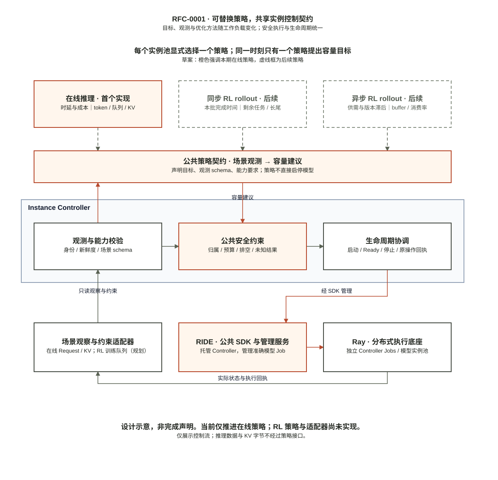
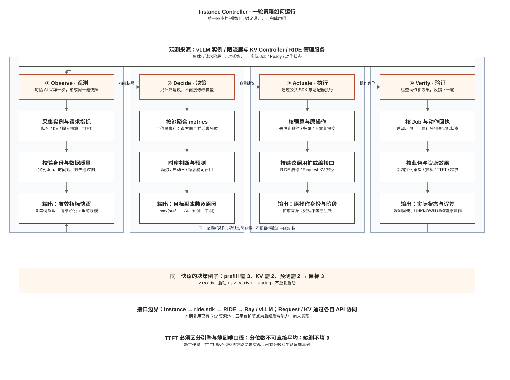
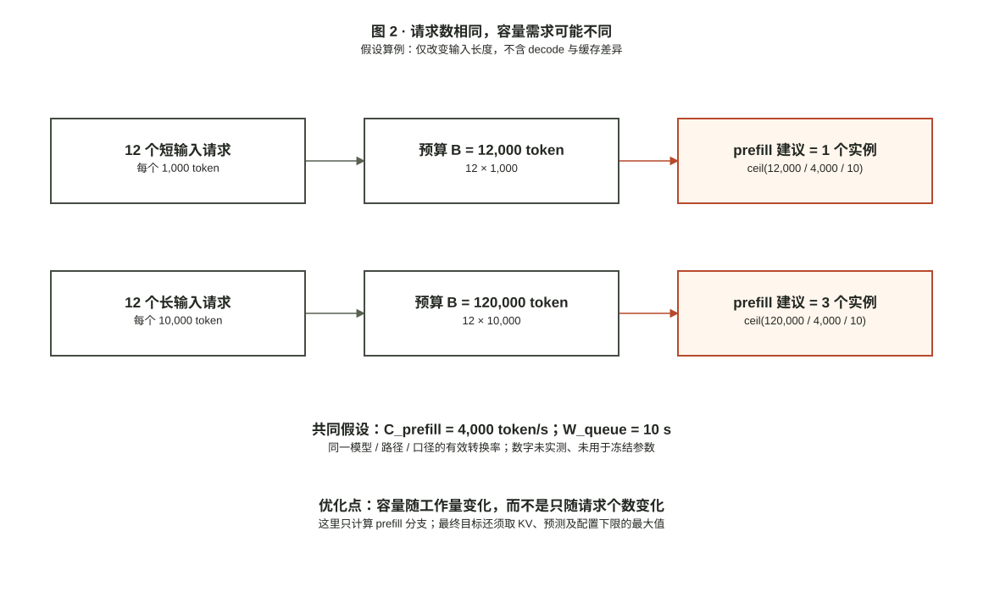
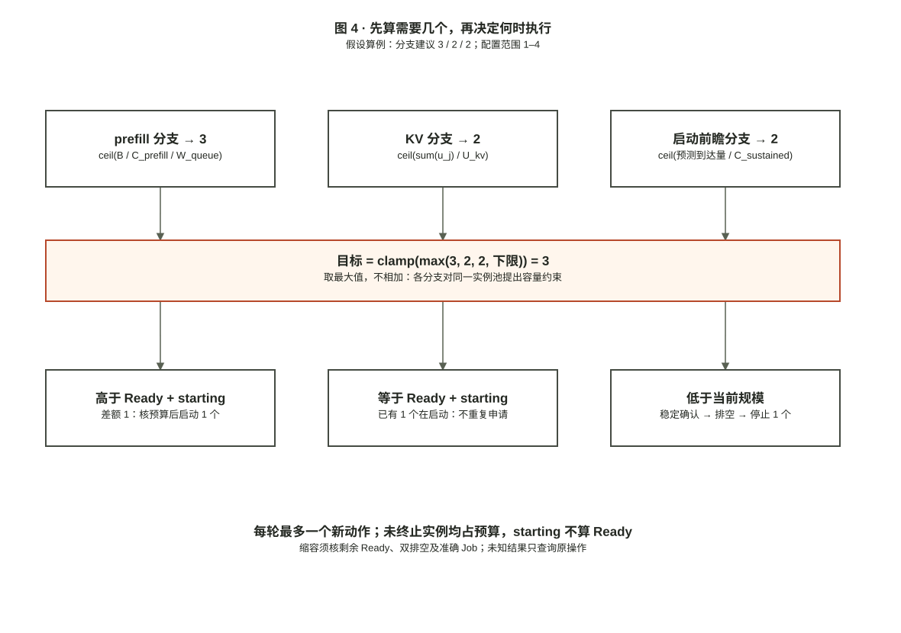

# RFC-0001：可替换策略的实例自动扩缩容——公共控制契约与在线推理首个实现

| 字段 | 内容 |
|---|---|
| 状态 | **Draft，待评审** |
| 作者 | RIDE研发代理，按毛言粲的讨论要求起草 |
| 决策人 | 毛言粲（myc） |
| 技术评审者 | 待指定；未代签任何维护者 |
| 创建/更新 | 2026-11-06 |
| 影响仓库 | instance-controller、request-throttling-controller；复用ride与kv-controller接口 |
| 关联 | [长期规划](../PROJECT_PLAN.md)、[统一设计](../architecture/INDEPENDENT_CONTROLLERS.md)、[效果契约](../architecture/CONTROLLER_EVALUATION.md)、[路线图](../architecture/CONTROLLER_ROADMAP.md) |
| 实现状态 | 本RFC的新观测和策略尚未实现或验证；现有能力不代表本设计已验收 |

## 1. 摘要

实例扩缩由两层组成：公共实例控制循环负责身份、能力与观测校验、预算、安全启停、排空和恢复；可替换场景策略负责目标、所需观测和容量建议。普通在线推理、同步RL rollout、异步RL rollout及离线批处理具有不同目标，不能统一用请求时延或token吞吐验收。

本RFC规定公共策略契约，并把带工作量反馈和可关闭启动前瞻的在线推理策略作为首个实现。RIDE继续托管独立Controller及管理准确模型Job，Ray执行；场景适配器提供公开观测和约束，策略不直接操作模型或平台。本期不实施RL训练/rollout策略，RL接口和目标仅为后续设计，不代表已有支持。



[PNG](assets/0001-instance-policy.png) · [可编辑draw.io](assets/0001-instance-policy.drawio) · [结构源文件](assets/0001-instance-policy.json)。白底、细线、橙色强调；虚线策略为后续范围。图只展示控制流，不是运行回执。公共循环有既有生命周期基础，新策略接口仍待实现。

在线推理首个策略的目标是在约定的完成、质量、时延与公平性约束下减少设备预约，或在相同资源上限下改善完整任务完成。其他场景按各自目标验收，不能由在线策略的结果推断rollout训练收益。本文不报告收益，不授权资源创建。

## 2. 问题、背景与运行例子

### 2.1 现有路径及缺口

业务路径为客户端→限流层（Request Throttling Controller）→模型。管理服务不在每次推理路径上。现有Instance策略由活跃与等待请求计数产生目标副本，再通过RIDE启动、Ready后激活、请求/KV排空和准确Job停止。

现有代码提供生命周期基础，但请求数量不足以描述输入长度、生成时长和缓存差异；`starting`不是可服务容量，低负载也不意味着实例内任务和状态已结束。限流层尚无本RFC需要的完整token/阶段观察，排空仍为保守全局排空。

当前源码依据：[Instance计数策略](https://github.com/yancanmao/instance-controller/blob/08f85c0053ab6eb5953085abac2fa5fcbad43bb1/src/instance_controller/policy.py)、[限流层成员与统计](https://github.com/vLLM-HUST/request-throttling-controller/blob/39152274bab352a31075ea5154f36ced13b143ed/src/thunderagent_controller_mod/ride_membership.py)。这些是源码行为定位，不是当前新方案的实测验收。

### 2.2 场景不同，目标与约束不同

| 场景 | 目标 | 必要观测/约束 | 不应如何验收 |
|---|---|---|---|
| 在线推理 | 时延、完成率等约束下减少预约 | 请求/token、队列、启动、缓存与任务归属 | 不只看设备利用率或副本数 |
| 同步RL rollout | 在资源预算下尽快完成本批可接受样本、减少训练等待 | 批次身份/封口、剩余任务、尾部进展、策略权重版本、可分配任务 | 不以平均请求时延或生成token/s替代本批完成时间 |
| 异步RL rollout | 满足训练消费并限制样本滞后，优化可接受样本供给成本 | 缓冲区深度/年龄、训练消费率、样本接纳/丢弃、权重版本及滞后限制 | 不把缓冲区堆积或被拒样本算有效收益 |
| 离线批量推理 | 在截止与成本预算内完成固定工作 | 剩余任务、执行进展、截止和可用预算 | 不把任务截止当作通用业务HTTP timeout |

这些是目标设计，不是上述场景已获得的效果。同步rollout只剩绑定长任务时，新增实例未必能接走工作；异步rollout生成过快也未必加速训练。必须核所需调度、样本接纳和版本能力。训练资源由训练系统拥有，本Controller只能管理已授权的rollout实例池，不能擅自停训练Job或重分配其设备。

### 2.3 在线推理的假设例子

假设实例启动需要60秒，需求在30秒内持续上升。等队列严重积压才启动，新增容量可能晚到；若随后仅有10秒尖峰，启动完成后也可能没有业务。负载下降时立即停止，则下一波需要再次支付启动成本。以上数字仅解释机制，不是实测或计划参数。

因此Controller必须分别判断：需要多少可服务容量、何时启动才能及时生效、何时可以安全且划算地释放。预测无法保证提前识别无历史迹象的首次突发，保留容量与省资源之间存在真实取舍。

## 3. 目标、非目标与成功定义

### 3.1 目标

- 公共实例池按明确模型/版本/布局和归属管理，单写者，每池仅一个活动容量策略；场景目标不写死在公共执行循环。
- 场景策略显式声明观测schema、能力要求、目标和结果口径；首个实现仍限定同构在线推理池。
- 在线推理v1自动策略保持至少一个Ready实例，scale-to-zero不在首轮范围；初始启动可从0准备到下限，但不能宣称准备期间已满足Ready下限。
- 请求计数基线、工作量反应式策略、加启动前瞻的策略可分别选择；相同观测下可比较。
- 每个建议关联观测、配置/标定SHA和准确Job，执行后核实际Ready、转发、排空与终止。
- 失败/未知不破坏已有服务或越过资源上限；业务等待无timeout、不自动重试。
- 分别证明工程正确、策略生效、收益/代价；无收益和证据不足必须可区分。

### 3.2 非目标

本期不实现同步/异步RL rollout算法、训练协同或样本重分配，不能因留出接口就宣称支持RL；不修改模型加载器、通信内核、TP/PP布局或P/D组织；不实现KV字节搬运、跨Controller原子事务、多写者高可用、任意非空Router恢复或最优策略搜索。不改变原ThunderAgent调度公式，不创建平台资源或新部署体系。不恢复暂停的SWE/B1研究。

### 3.3 可证伪问题

公共契约是否能在不修改生命周期核心的情况下承载不同目标，并拒绝不满足能力的策略？在线推理中，工作量反馈是否优于合理调节的计数/队列策略？同工作量策略下，启动前瞻是否改善时延—预约成本取舍？缩容稳定窗口是否减少重复冷启动而值得额外常驻成本？三项分别消融，不把组合默认视为更优。

## 4. 相关工作与选型依据

| 来源 | 采用范围 | 证据与限制 |
|---|---|---|
| [Dynamo Planner](https://docs.nvidia.com/dynamo/knowledge-base/modular-components/planner/choose-a-planner-mode) | 需求/容量/预测与执行反馈的整体结构 | 不能由其文档推断当前Ascend及FPM/性能估计链路已接通；本文不搬整套运行环境 |
| [llm-d推荐扩缩入口](https://github.com/llm-d/llm-d/blob/343d9be9813020f43aeb5a5b97cb459102bb5893/guides/workload-autoscaling/README.md) | 在途请求/队列基线 | WVA已废弃；推荐路径与实验路径分开，不新引入WVA |
| [llm-d token-aware规则](https://github.com/llm-d/llm-d/blob/343d9be9813020f43aeb5a5b97cb459102bb5893/guides/workload-autoscaling/keda-epp-token-aware/optimized-baseline/base/scaledobject.yaml)及[说明](https://github.com/llm-d/llm-d/blob/343d9be9813020f43aeb5a5b97cb459102bb5893/guides/workload-autoscaling/keda-epp-token-aware/README.md) | 共置实例的积压与KV双触发建议 | 官方Experimental；复用规则思想并披露观测差异，不宣称完整等价移植 |
| [arXiv:2609.20874v1](https://arxiv.org/html/2609.20874v1) | 简单平滑、启动前瞻、有界预测余量及消融 | 完整策略以模拟为主，硬件只验时序机制并注入固定延迟；正文称代码待发布，不充完整实机背书 |
| [Llumnix，OSDI24](https://www.usenix.org/conference/osdi24/presentation/sun-biao) | 状态影响重配置的动机及后续强相关基线 | 本RFC不实现其请求/状态迁移，不能声称已拥有迁移能力 |

llm-d来源固定为343d9be9813020f43aeb5a5b97cb459102bb5893，[许可证为Apache-2.0](https://github.com/llm-d/llm-d/blob/343d9be9813020f43aeb5a5b97cb459102bb5893/LICENSE)。实现时记录实际引用文件SHA、保留归属并列适配差异。其他论文固定所引版本，Dynamo源码身份实施前核定；不复制上游硬件容量常数。统一接口或组合已有机制本身不构成研究新颖性。

## 5. 所选设计与不变式

### 5.1 责任与信息流

| 执行者 | 负责 | 不负责 |
|---|---|---|
| Request Controller | 请求/任务身份、token和阶段观测、新分配屏障、排空 | 模型启停、预测副本数 |
| 场景策略（Instance内可替换组件） | 声明目标/观测要求、计算容量建议 | 直接调用RIDE/Ray启停，绕过公共约束 |
| Instance公共控制循环 | 收集并验证场景观测、调用一个策略、检查建议、持久化和协调 | 写死在线SLO、读取训练私有内存、管理平台或搬运KV |
| KV Controller | 能力、未完成状态动作与排空回执 | 擅自释放模型或证明未支持的复制 |
| RIDE | 托管独立Controller及模型、准确Job启停/状态/日志 | 代理每次推理、嵌入扩缩算法 |
| Ray | 执行和资源调度 | 判断任务已经结束或状态可释放 |

每轮先读并验证观测，计算建议，执行最多一个新生命周期动作，随后持续查询效果。跨服务读不是一致快照；必须记录采样跨度并在执行端再次检查前置条件。

### 5.2 必须成立的不变式

1. `starting`占预约与副本上限，但只有Ready且已激活的准确Job算可服务容量；`draining/stopping`尚未终止前仍占上限。
2. 停止后剩余Ready副本不得低于下限。工具等待不等于program结束；不得截断业务来制造排空。
3. 每个外部动作先保存操作身份；未知结果只查原记录，不换ID盲投。状态所有者世代或Job变化必须拒绝自动接管。
4. 指标缺失、陈旧、重复实例或身份不明不填0；无法证明动作安全时不新增自动变更，保留已有服务。
5. 业务timeout统一禁用；目标时延是优化约束，不是取消请求的期限。运维资源截止独立执行和归因。
6. 策略只能使用当前请求和历史观察；不读未来到达、真实未来输出或工具返回时间。

### 5.3 公共策略契约（拟议，尚未实现）

每个实例池通过配置选择一个本地安装、固定版本的策略。策略可以由独立Python包提供，但由同一个Instance Controller进程调用；不为每个算法再启动一套执行服务，不自动下载插件。公共循环通过适配器读公开数据，不import其他Controller或训练系统的内部实现。

| 契约 | 内容 | 所有者 |
|---|---|---|
| `StrategyDescriptor` | kind/version/代码SHA、适用场景、目标、所需观测schema、所需执行能力 | 场景策略声明；公共循环校验 |
| `ScenarioObservation` | 场景schema版本、owner/epoch、实例/Job与采样身份、新鲜度、对应场景payload | 场景观察适配器提供；公共循环验证 |
| `CapacityRecommendation` | 目标副本数、观测/配置/策略身份、原因、目标含义及生效条件 | 策略返回；不是执行命令 |
| `ExecutionFeedback` | 公共循环的动作/操作ID、准确Job、实际阶段、失败或UNKNOWN | 公共循环记录并反馈，策略不得伪造完成 |

调用顺序为`validate capabilities → observe → validate observation → recommend → validate constraints → reconcile → verify`。策略函数只提出建议；请求/KV屏障、预算、下限、归属、版本、幂等和未知结果处理不由插件替换。目标副本数即使合理，执行前置不满足仍不执行。

在线payload包括请求/token/队列与缓存；同步rollout payload需要本批进展和版本；异步rollout payload需要缓冲与消费/接纳及滞后。它们使用各自schema，不强迫rollout伪装在线请求队列。缺所需观测、版本或执行能力时拒绝启用，不将字段填0或静默套用在线策略。

例如，策略若要求“把剩余任务分到新副本”，执行端必须明确支持任务重新分配；仅支持模型启停就不能接受这个能力声明。batch封口/完成与样本接纳由工作负载系统确认，token生成结束不等于样本被训练接受。后续RL策略须另有策略RFC/专项验收，当前不增加训练执行动作。

切换策略必须先确认无未核清的执行操作、保存原配置与状态、核新能力，再用新配置身份生效；保留公共生命周期账，预测等策略私有状态不得跨不同kind/version解释。不能由两个策略同时写同一池目标，不热切换来绕过排空或未知结果。

公共下限来自已批准池配置；在线v1要求至少一个Ready是首个策略的约束，不强制所有未来场景常驻。rollout能否缩到零、何时暂停/恢复等另行定义能力并验收，本RFC不预先承诺。

### 5.4 一个策略怎样运行：统一四步工作流与数据流



**图：一轮策略从实例观测开始，经指标聚合和时序判断产生容量建议，通过RIDE及其他Controller的公开接口执行，再以真实状态和业务指标反馈下一轮。** 上方四步表示阶段顺序，每列展开该阶段的内部处理；这不是四个独立服务，也不要求四个独立仓库。四步共同构成独立Instance Controller的一轮控制循环，RIDE托管该进程。

[高清PNG](assets/0001-controller-workflow.png) · [可编辑draw.io](assets/0001-controller-workflow.drawio) · [结构源文件](assets/0001-controller-workflow.json)。本图取代仅列启动时刻的框图，作为策略实现的主工作流；第6–7节再展开每个技术环节。

| 阶段 | 实际处理与数据流 | 输出给下一步 |
|---|---|---|
| **Observe：周期性观测** | 每隔配置周期Δt，经只读适配器读取vLLM负载、限流层请求/输入预算/任务归属、KV状态及RIDE准确Job/阶段。每个样本带实例身份、时间和能力；新指标链路尚待实现 | 当前池的有效指标快照；缺测显式标记，不填0 |
| **Decide：聚合、时序判断、决策** | 对同模型/布局/口径求预算总量，分别保留每实例KV；统计Ready/starting。用历史到达窗口估计趋势和启动后的需求，用持续低需求窗口确认缩容；计算第7节的各分支及最终目标 | desired副本数、原因、观测/配置身份；不直接产生外部副作用 |
| **Actuate：通过适配器执行** | 先核原操作和预算。扩容：`ride.sdk`请求RIDE启动准确模型Job，Ray准备vLLM，Ready后激活Request/KV成员。缩容：Request停止新分配→请求与KV双排空→RIDE条件停止准确Job。扩缩是互斥分支 | 操作身份、准确Job及当前阶段；API受理不代表完成 |
| **Verify：验证并闭环** | 查询原动作和Job，核新实例是否激活并真实承接请求、旧实例是否终止释放；下一窗口重新观察排队、TTFT及负载。未知结果继续查原操作，业务未改善不能仅凭副本变多报成功 | 实际可服务规模、动作结果及预测误差，反馈下一轮Observe/Decide |

TTFT在这里有两种作用：用于标定/核验时延目标，以及验证新增容量是否改善业务。**它不是本RFC已有公式中的独立“超阈值就扩一个”触发器**；单独TTFT升高无法区分输入变长、decode干扰、排队、冷启动或其他故障。当前容量建议仍由预算/KV/可选预测产生。若后续把TTFT直接纳入控制律，须定义作用方式及标定，不能只在图中画一个指标就称算法已使用。

聚合时不得平均每实例p95。只有来源、边界、窗口及直方图bucket一致时，才能合并计数后计算池级分位；只有实例分位数而无原始分布时，保留各实例值或标池级分位不可用。引擎TTFT与经过限流层的端到端TTFT分别记录，不混成一条时间序列。业务无限等待不改变该测量定义。

执行后端应保持可替换，但当前实际生命周期入口是`ride.sdk → RIDE → Ray/model Job`，不是Controller直接创建云平台资源，也不存在通用的“调用vLLM扩副本”接口已被接通的声明。需要云平台扩节点时，应在RIDE的执行后端明确资源范围、权限和回执后接入；当前未实现。这样策略仍计算容量，后端负责资源与实例落地，不把云平台细节写进算法。

## 6. 技术设计：从请求计数转向工作量与生效时间

本节及第7节按论文Design组织：先说明决策失配，再给出观测模型、容量计算和执行算法。所有图中的数字都是用于解释机制的假设算例，**不是模拟结果或硬件测量**；协议字段移至[附录A](#附录a在线观测接口与协议细节)，不让接口清单代替技术解释。

### 6.1 问题本质：扩缩容是一个有延迟、有状态的决策

在线实例池要在完成率、输出正确性、时延及公平性约束下，尽量减少设备预约；相同资源上限下也可比较完整任务完成。这里的成本是所有已预约实例随时间的累计，而非某一刻的Ready副本数；启动、排空和停止中的预约都不能忽略。目标时延用于规划与评估，业务请求不因越过该目标而被取消。

对同构池，可把代价写为`A = ∫ N_allocated(t) dt`（实例·秒）；每实例固定占用g张设备时，设备预约为`g × A`。优化目标是在预先固定的完成/质量及可测时延约束下减小A，而非单独最小化实例数。时延约束的统计口径和阈值由第11节的配对协议冻结，不能由本例虚构。在线决策只依赖截至当前的观测，不以未来完整负载求出事后最优，再冒充可执行策略。

仅根据当前请求数决定副本有三处失配。首先，同样多的请求可能包含完全不同的输入工作量。其次，决定启动与新增实例可转发之间有真实延迟，看到压力才启动可能晚到。最后，需求下降不等于已绑定任务或KV状态消失，立即缩容可能破坏业务，也可能在下一次上升时重复付启动代价。三处失配分别对应工作量反馈、启动前瞻和稳定确认/排空，不能靠一个阈值同时解决。

### 6.2 关键思路一：让容量对工作量敏感



**图2：改变决策依据，而非修改引擎执行。** 两组均有12个请求，仅输入长度从1,000变为10,000 token。若有效预算转换率为4,000 token/s、排队规划预算为10秒，prefill分支分别给出1与3个实例。请求计数在这个例子中没有变化，工作量则变化了10倍。图仅推导该分支的建议，不能单独决定实际副本数，更不证明增加实例必然消化已绑定工作。

这里的B表示已接收且尚未观测到首个有效生成事件的完整输入token预算。它刻意使用可核验的上层口径：限流层能确认请求身份、输入长度和流式生成阶段，却未必知道引擎精确还有多少未计算token。首次版本不对缓存命中作未经验证的折扣；代价是可能高估需求，尤其是高缓存命中或首decode较慢时。因此标定、候选和基线必须使用同一口径，高缓存场景也是必须测的失效边界。

### 6.3 关键思路二：把所需容量对齐到实际生效时刻

[图3：启动时序的辅助算例](assets/0001-startup-design.png)（主工作流见第5.4节）

**图3：提前的是启动决策，不是模型加载。** 假设t=0已有上升趋势，预测t=60秒需要3个实例，实际提交到可转发也需60秒。只对当前压力反应的策略可能到t=60才启动、t=120才Ready；前瞻策略在t=0启动，争取t=60可用。这只是满足图中条件时的机制解释，未规定所有反应式策略都会等到t=60，也未证明本预测能准确看见未来。

预测值由当前及历史到达构造，不能访问未来负载。前瞻失败的成本是过早或多余预约；短暂尖峰还可能在启动完成前消失。因此预测是可关闭的增量模块，以同一工作量反应式策略为直接基线。若不能改善时延与预约成本的取舍，就保留反应式策略，不因算法更复杂而默认采用预测。

### 6.4 从观测到建议：三个量，三种含义

| 量 | 回答的问题 | 为什么不能互相替代 |
|---|---|---|
| 输入预算B、有效转换率C_prefill、排队预算W_queue | 当前预算压力需要多少实例？ | 是预算代理，不是精确剩余工作；不直接保证全部排队时间 |
| 各实例KV占用u_j、阈值U_kv | 状态容量是否形成压力？ | 占用不等于decode计算压力；新增空实例也不会自动搬走旧KV |
| 到达速率、前瞻时间H、持续能力C_sustained | 新容量可用时，需求可能需要几个实例？ | 持续能力含业务混合及约束，不能用空载prefill转换率代替 |

这三项是对同一个实例池的不同容量建议，取最大值而不是相加，避免把重叠需求重复计算。它们也不是完整排队论模型：共置prefill/decode相互干扰，KV分布和绑定会限制扩容效果。第一版限定在经标定的prefill压力主导区间，decode压力与状态偏斜作为保护/边界；超出区间时不宣称SLO保证。

在线观测如何计数、如何区分有效首token、缺测如何处理，见附录A。场景策略只读取适配器给出的公开观测并返回建议，不直接调用模型或平台。RL将使用不同的观测和目标，不能套用本节在线公式来证明训练收益。

## 7. 技术设计：实例数量、启动时机与安全缩容

### 7.1 标定与配置

标定产物必须固定模型、布局、服务路径、token口径、缓存配置、输入/输出类别及SHA。它不放在RIDE核心硬编码，按benchmark归档与配置引用。

| 符号/配置 | 单位 | 用途 |
|---|---|---|
| C_prefill | token/秒 | 同口径预算除以空载首token时间得到的有效转换率，用于预算积压换算；不是纯引擎kernel吞吐 |
| C_sustained | 到达token/秒/实例 | 给定输入/输出混合及约束下实测可持续到达能力，供预测容量映射；不能直接拿C_prefill替代 |
| W_queue | 秒 | 允许的排队预算；由目标时延扣除同类输入的空载底线与余量决定，必须为正 |
| U_kv | 0到1之间 | 同构实例KV占用阈值，必须核实际指标语义 |
| H | 秒 | 本环境提交→Ready→限流层可转发的前瞻时间，初次/重复启动分列 |
| min/max、稳定窗口、alpha、余量系数/上限 | 显式配置 | 不继承未核的上游数值；正式比较前冻结 |

若空载底线已超过目标，标为当前配置不可满足，不靠无限加副本“解决”。共置prefill/decode相互干扰，C_sustained只适用于标定的混合区间；区间外不得静默外推或宣称SLO保证。首次实验限定prefill压力为主，decode压力作为约束/边界；通用decode性能模型不在v1承诺中。

启动配置必须校验所有数值有限、C_prefill/C_sustained/W_queue及控制间隔为正、0<U_kv<1、0<alpha<=1、H和稳定窗口/余量系数非负、在线v1的1<=min_replicas<=max_replicas且池覆盖上限。选择新策略时缺标定或能力即拒绝启用，不影响未变更的旧计数配置；不能把NaN、负数或bool当合法计数/参数。

### 7.2 工作量反应式：当前需要几个实例

对prefill分支，B / C_prefill把当前预算换算为单实例的等效处理秒数；再除以W_queue，得到在规划窗口内分摊该预算的实例建议。这依赖近似可分担和同口径标定，不是确定的清空时间。对KV分支，将池内同构实例的占用相加并除以目标占用，得到聚合容量建议。后者不能保证每个旧实例都降到阈值，状态偏斜没有被迁移自动解决。

在观测完整且身份、新鲜度合格时，令B为预算token，u_j为准确活跃成员的KV占用：

```text
prefill_recommendation = ceil(B / C_prefill / W_queue)
kv_recommendation      = ceil(sum(u_j) / U_kv)
reactive_recommendation = clamp(max(min_replicas,
                                    prefill_recommendation,
                                    kv_recommendation), min_replicas, max_replicas)
```

这是对所引llm-d双触发规则的RIDE执行适配，新增的完整输入预算口径不是逐行复刻。KV占用是容量压力，不等于decode计算负载；ITL等恶化但KV不高属于必要边界。增加新副本不能自动迁走已绑定任务，判断收益须核新增实例真实承接业务与旧实例进展。

### 7.3 启动前瞻：何时开始准备容量（默认关闭）

从已接收token累计量与实际采样间隔计算到达速率x，不能用完成计数估计被限流/饱和截断的需求。只对已经到达限流层的需求建模，不假设观测到客户端尚未提交的任务。

```text
smoothed = alpha * x + (1 - alpha) * previous_smoothed
trend = (smoothed - previous_smoothed) / elapsed_seconds
point = max(0, smoothed + H * trend)
margin = min(coefficient * historical_prediction_error,
             margin_fraction_limit * point)
predicted_recommendation = ceil((point + margin) / C_sustained)
desired = clamp(max(reactive_recommendation, predicted_recommendation), min, max)
```

以图3为例，假设平滑到达为3,000 token/s、趋势为每秒增加50 token/s、H为60秒，则前瞻点为6,000 token/s；若同业务混合的C_sustained为2,000 token/s/实例且示例余量为0，预测建议为3。这里C_sustained与图2的C_prefill不是同一个参数；全部数值只为解释计算。最终仍与即时压力建议取最大值，不允许预测低估撤掉当前需要的容量。

预测误差仅在对应历史预测到期后更新，不能提前读取未来；前两个有效速率窗口未齐时只用反应式。H不是手工注入sleep；样本少时记录观测上界与不确定性，不声称统计分位保证。余量有界、总副本有界，每轮最多一个新动作。预测只提高反应式所需容量，不能压低即时压力保护。

C_sustained失配、采样重置或混合负载超出标定范围时，不执行预测建议，原因入日志；是否仍可执行反应式取决于其所需观测是否独立完整。配置变更/进程重启需先恢复生命周期账，再重新积累预测窗口；不跨进程复用旧单调时间。

### 7.4 缩容稳定性：何时释放而不反复启停

扩容与缩容采用不对称的时间规则：扩容在观测及预算合格时及时准备，缩容则等待低需求持续成立。缩容稳定窗口购买的是对短暂低谷的容忍，支付的是额外预约；它既不能证明低谷结束后一定反弹，也不能替代任务和状态排空。例如目标从3降到2仅持续20秒，若示例稳定窗口为120秒，就保留3个；持续120秒也只能开始安全排空，并非到点强制终止。上述20/120秒仅解释规则，正式参数需冻结。

降容建议必须在完整、新鲜观察下持续满足稳定窗口；窗口内出现缺测、反弹或身份变化则重新确认。首先确保剩余Ready容量满足下限，再选择准确实例进入draining，之后不因迟到activate撤销排空。实际停止仍取决于双排空。

当前全局排空会限制持续流量下的缩容。因此v1在可排空波谷/完整批次验证释放，不能声称不停流的目标实例排空已完成；若它主导成本，提交独立正确性设计，而不是放松条件。复用模型池现有确定性选择顺序，不同时加入路由或迁移优化。

### 7.5 完整决策过程：目标数不等于立即执行数



**图4：计算与执行分离。** 在图2的长输入算例上，prefill建议3，聚合KV占用1.4、阈值0.7时建议2，另假设前瞻建议2；若配置下限为1、上限至少3，最终目标为3。若2个Ready、没有starting，则差1个，核预算后启动；若2个Ready且1个starting，则等待该操作，不重复申请；若4个Ready，则低需求持续确认后先排空1个。图中三种执行情况是互斥例子，不是同时执行三个动作。

```text
每次控制循环：
    先恢复/查询已有操作，核身份、能力、标定和观测
    若有未核清的操作结果，或必要观测不合格：
        不新增自动变更；继续查询原操作并保留服务

    reactive = 当前 prefill / KV / 下限的最大建议
    desired = reactive
    若显式启用前瞻，且窗口、标定与能力均合格：
        desired = max(reactive, predicted_recommendation)
    desired = 限制在已批准的最小、最大实例数内

    核 all_live = Ready + starting + draining + stopping 等未终止预约
    若已有生命周期操作在进行：继续原操作，不新增动作
    否则若 desired > Ready + starting：
        若启动后仍在副本/资源上限内：记录身份，经 RIDE 启动 1 个
    否则若 desired < Ready：
        若低需求持续满足稳定窗口，且移除后仍满足 Ready 下限：
            选择 1 个准确实例，进入请求/KV排空流程
    否则：维持当前规模

    只有 Ready 且激活后才计为可服务；只有终止确认后才计为释放
```

差额表达“最终还缺多少”，每轮至多一个新动作表达“本次执行多少”；不能把desired从2升到5理解为立刻并行提交3个未知结果的Job。串行生命周期也会让大幅扩容更慢，是本期保守执行的真实代价，必须计入前瞻效果，不用目标副本数冒充实际Ready曲线。

### 7.6 优化假设、验证和失败边界

| 设计机制 | 预期改变的因果环节 | 直接对照与必测反例 |
|---|---|---|
| 工作量反馈 | 相同请求数下区分长短输入，改变容量建议 | 对合理调节的计数/队列基线；测高缓存命中导致预算高估、混合负载失配 |
| 启动前瞻 | 把启动放到需求出现之前，缩短容量晚到的时间 | 同工作量策略关闭/开启预测；测无预兆短突发、趋势反转、启动估计偏差 |
| 缩容稳定窗口 | 减少短低谷里的停止和再次冷启动 | 相同策略的预注册窗口对照；同时测保留额外预约、长低谷浪费 |
| 公共安全执行 | 容量建议不截断任务、不重复启停、不误停Job | 核实际请求/KV终态和原操作回执；这类正确性证据不能替代性能对照 |

预期收益来自减少容量错配及重复启动，预期代价来自观测、保留容量和预测误差。最终按完整任务完成、质量、时延、公平性与累计预约共同判断；不能只用“多启动了一个”或局部吞吐上升判定优化有效。当前全局排空、无状态迁移和保守串行操作均保留为适用限制，不在图中隐藏，也不作为新技术贡献。复用已有策略思想与控制契约本身不构成论文创新；是否形成研究贡献取决于后续证据。

## 8. 执行、失败与恢复

| 触发 | 必须行为 | 禁止行为 |
|---|---|---|
| desired高于有效容量 | 计入starting、核未终止预约上限，通过RIDE保存身份后启动 | 重复启动正在准备的副本、把starting当Ready |
| 模型Ready | 核准确Job，版本动作激活KV/Request，再核当前状态 | 仅HTTP健康就认定已承接业务 |
| desired降低且稳定 | 请求屏障→观察排空→KV排空→准确Job条件停止→核终态/移除 | 中断工具等待或未知请求、跳过KV排空 |
| 观测缺失/陈旧/不一致 | HOLD新自动动作，保留服务，记录具体缺口；只读恢复观察 | 填0、随机重试业务或猜测资源空闲 |
| POST回复丢失 | 保持原操作UNKNOWN，查询原回执并核payload/身份 | 换ID或收到404就重新POST |
| 部分激活/排空成功 | 保留阶段与原回执，按真实状态核查；不把多服务动作当原子事务 | 清空数据库或撤销单向排空以“修复” |
| 实例/接收方世代变化 | 拒绝自动接管，要求核清所有权和未完成状态 | 沿用旧样本或停止同名新Job |
| 重启 | 恢复Journal/原操作，重新取得观测与预测窗口 | 把旧Mono时间当当前时间、清除未知以继续 |

模型和Controller的管理故障与业务错误分列；资源截止导致的中止不能归为策略失败。已在执行的动作不能通过切策略回滚；仅继续原操作核查/安全收尾。

## 9. 可观测性、安全与资源

每个tick记录观测ID/时间跨度、所有者/Job、token口径与完整性、标定/配置SHA、各子建议、最终目标、当前Ready/starting/draining/stopping、动作/原因、操作ID及真实结果。扩容核新增Job承接请求；缩容核最终终止与释放。身份已退出的序列必须清除，指标按本池精确过滤。

新接口沿peer token认证与受信网络边界，actor_id不是ACL身份；不新增外网端口、权限或自动插件下载。日志/指标不存prompt、token IDs、生成内容或凭据，细粒度请求与原件按私有证据规范归档。tokenization与采样开销必须计入，并在所有实验臂共同启用；观察失败不能取消业务。

RIDE只管理已有归属对象。平台资源另按每轮准确授权/模板/设备唯一性和绝对截止冻结；RFC本身不创建工作区、RayCluster或卷。已有管理截止不改变单请求无限等待，归档清理不触碰其他聊天、shuhao、他人或共享数据。

## 10. 兼容、启用与回退

1. 保持现有计数策略默认，新增策略与接口显式版本协商；旧配置不被重新解释。
2. 第一阶段只记录候选建议，不执行；先验证token/阶段/Job记账及预测无未来信息。
3. 新冻结窗口先启工作量反应式，通过真实资格和对照后再单独启预测；不热改运行中的组合。
4. 关闭预测只停止产生新预测建议；既有drain/start/UNKNOWN继续按原身份处理。停止Controller不隐式停止模型。
5. 如需退回旧程序，必须先核新状态兼容；不清空Journal或让旧版本接管新增状态。不能安全接管时保留现有模型，转人工核查。

## 11. 验证与收益判定

### 11.1 公共契约与软件验证

公共层必须验证策略隔离、每池单一策略、schema/能力不匹配拒绝、越权建议拒绝、策略切换及旧状态保护。可用同步/异步rollout的软件fixture验证不同payload和目标不会泄漏到执行核心；这只证明契约扩展性，不是RL rollout或训练效果验收。实际RL验收以后续策略RFC为准。


必须覆盖tokenizer身份/计数不一致、SSE分块/空delta/取消、重复hook、统计重置、过期/跨Job样本、预测窗口不足/时间倒退、输入区间外、未知结果、上限与最小Ready、双排空、迟到激活及重启恢复。经Service/实际tick测试，不只调用公式。运行各改动仓原`tools/check.py`；软件测试不替代Coder或NPU。

### 11.2 首个在线策略的真实资格

沿现有RIDE one-click入口，实际核平台UI、owner/对象/设备、源码/配置/模型、Ray Jobs与可转发端点。少量真实流式多轮验证新输出继承、阶段观测、取消/释放、Ready后激活与安全缩容。未支持的非流式路径必须测能力拒绝及业务持续服务，不伪装完整阶段观测。

### 11.3 在线推理配对和指标

固定1、固定2、计数/合理延迟、工作量反应式、加预测五种配置；预测增量比较最后两者。先混合输入长度的持续爬升，再有历史趋势的重复突发；无趋势短突发、预测过冲、缓存变化、decode压力为边界。所有臂共同路径/观测、设备上限、模型/布局、缓存设置及初始容量说明，不等新实例Ready才发负载。

首个服务发现可用固定输入单轮批次隔离反馈差异，仍真实生成且完整终态；它不能核销多轮/Agent收益。正式多轮必须反馈自身真实输出并核工作量，输入/质量差异不静默忽略，不丢弃不利任务制造配对。

至少三组新鲜交替重复及未用于调参的留出，发现不充验证；波动不能区分则待定。主要指标为全体任务完成/错误、完整批次与任务时延、启动次数/时间、排空/控制开销和设备预约。TTFT/ITL只有真实口径可信后才支持其SLO结论；无精确授予时刻只报采样预约估计，集群内释放不代表平台申请减少。

按[效果契约](../architecture/CONTROLLER_EVALUATION.md)在正式运行前冻结主指标、质量/长尾/公平性约束和最小有意义差异；这些数值不是本RFC已测结果。未通过资格、缺强基线、未完整或资源截止中止均不得报收益。性能原件、图/表/统计代码及结果进入benchmark托管，RFC仅链接。

## 12. 分阶段交付与依赖

本期只交公共契约与在线首个策略，RL实现不并行铺开。按现行3–4天首轮目标推进，非保证全部通过或正收益：第1天观测/资格与标定；第2天反应式对照；第3天预测消融、独立重复与留出；第4天复算、边界与决策。工作量不足以装入窗口时先保必需对照，拆新窗口而不延长旧截止；缺项如实未完成。

前置依赖为等价token计数、可信首token/阶段事件、实际KV指标语义、当前模型/路径标定与安全生命周期。任何依赖缺失都先交付具体缺口和替代验证，不默认上线近似口径。3–4天优先取得首个可信判读，不把这一目标当资源授权或调低标准的理由。

## 13. 替代方案与取舍

| 方案 | 为什么不作为当前主方案 | 何时重审 |
|---|---|---|
| 只调计数阈值 | 不区分长短输入，保留为强基线 | 若混合负载下已足够好，采用基线结束复杂候选 |
| 只看设备利用率 | 不直接表达排队与状态压力 | 有校准证据证明其预测价值时作为附加观测 |
| 全量接入Dynamo/llm-d平台 | 改动事件/执行/部署体系，当前只需独立策略 | 出现外部平台集成需求并另做适配资格 |
| 复杂预测器或强化学习 | 未证明简单前瞻不足，标定和验证成本高 | 简单预测明确失败且有足够训练/验证数据 |
| [BlitzScale](https://www.usenix.org/conference/osdi25/presentation/zhang-dingyan)/[HydraServe](https://www.usenix.org/conference/nsdi26/presentation/lou)加载改造 | 涉及底层加载/通信/运行时，超出策略适配 | 分阶段计时证明加载主导且具备底层协作 |
| [OpScale](https://arxiv.org/abs/2608.13499)算子级扩缩 | 改变扩缩单元及执行架构 | 完整实例粒度确实失配后单独立题 |
| 立即加入KV迁移/缓存路由 | 混淆实例策略贡献且后端资格未过 | 后续对应RFC及真实状态验证通过 |

## 14. 未决问题与决策记录

| 问题 | 本RFC推荐立场 | 不决定的影响 | 决定人/状态 |
|---|---|---|---|
| 是否接受公共循环与场景策略分离？ | 建议接受；本期只实现在线策略，RL为独立后续工作 | 决定接口是否将在线指标写死 | 毛言粲；待评审 |
| v1先支持何种阶段观测？ | 先支持可核验流式首token路径；非流式缺测不启工作量自动动作 | 决定接口和回放适配范围 | 毛言粲及接口维护者；待评审 |
| 是否允许完整prompt预算代理？ | 允许作为明示、同口径标定的实验估计；不称精确uncached工作量 | 不允许则需先补引擎阶段/缓存事件 | 毛言粲；待评审 |
| 预测先覆盖什么？ | v1先prefill压力主导，decode为保护/边界，避免虚假的通用模型 | 决定首轮可声称的适用范围 | 毛言粲；待评审 |
| 是否本轮修改全局排空？ | 不改；限制为可排空波谷/批次，若主导成本另提正确性设计 | 不能验持续不停流实例级缩容 | 毛言粲；待评审 |
| 参数与效果门槛何时固定？ | 同路径标定后、首个正式比较前；遵循既有协议 | 未固定不提交正式效果批次 | 实验负责人；待冻结，非本轮已授权参数 |
| 技术评审者与模型资格组合 | 实际维护者确认；小模型只作资格或限定场景，不外推35B/SWE | 不凭姓名或旧环境猜运行资格 | 毛言粲；待指定/冻结 |

尚无Accepted/Rejected决定，无实施或性能通过声明。后续修改记录接受的修订、理由、遗留条件及前序版本，不回写旧实验。实现状态只在路线图核销。

## 附录A：在线观测接口与协议细节

### A.1 复用接口

复用`ride.sdk`的模型生命周期、Journal、操作结果、准确Job条件；Request/KV的Instance成员对象、版本动作及原回执查询。对象`resource_version`只覆盖其持久成员状态，不冻结`observations`，不能把一次读到drained当作永恒许可。

### A.2 在线推理观察适配器：新增只读接口（拟议，当前不存在）

下面的`instance-controller.workload/v1`仅服务于首个在线策略，不是所有场景的公共观测schema。RL数据不会塞进此接口。建议限流层新增经现有peer token认证的`GET /control/workload`，并在capabilities声明`workload_observation_v1=true`。默认计数策略仍可接旧服务；选择工作量策略但缺能力时必须拒绝自动启用，不静默降级后仍按工作量策略记账。

该接口仅暴露本池聚合及准确成员身份，不暴露prompt、token IDs或生成文本。响应拟包含：

| 字段 | 类型/单位 | 定义 |
|---|---|---|
| `schema` | 字符串 | `instance-controller.workload/v1`，本接口版本，不改既有SDK对象schema |
| `owner_id`, `owner_uid` | 字符串 | 接收方身份/持久状态世代，与既有绑定核对 |
| `observation_id`, `observed_at` | UUID、UTC秒 | 采样身份与时间；不是分布式事务版本 |
| `pool_id`, `model_identity_sha256`, `tokenizer_identity_sha256` | 字符串 | 固定服务池、模型/布局与实际模板/tokenizer身份 |
| `token_accounting_mode` | 字符串 | v1建议`full_prompt_until_first_token`，含义见下文 |
| `token_observation_status` | `complete`或`unavailable` | 不可用时token量为null，绝不填0 |
| `prefill_budget_tokens` | 非负整数或null | 已接收且尚未观察到首个有效输出token的完整输入token预算 |
| `waiting_requests`, `decode_requests`, `unknown_requests` | 非负整数 | 本次采样的对应请求数，阶段定义固定 |
| `oldest_wait_seconds`, `waiting_observation_scope` | 非负秒或null、枚举 | 最老可追踪排队年龄及其范围；v1范围为限流层本地队列，不充引擎全队列，不以HTTP总时长代替 |
| `replicas` | 列表 | 每成员name、job_id、phase、sampled_at和可空的`kv_cache_usage_fraction` |
| `accepted_prompt_tokens_total`, `counter_epoch` | 累计整数、字符串 | 已接收工作量的输入计数及重置世代，预测到达速率用，不以已完成吞吐代替 |

接口必须验证精确字段/范围及池/Job身份。观测拼装、最大读取跨度、可接受时钟偏差和新鲜度是显式配置；不将服务端墙钟当跨节点单调时钟。相同observation不得重复更新预测器；counter世代改变后重建速率窗口。实例退出后其旧指标不得残留参与求和。

### A.3 token与阶段的v1定义

建议先支持可核验流式路径：进入限流层取得准确请求身份和引擎等价token计数后计入预算；观测首个含真实生成内容的有效输出事件后退出该预算并进入decode；正常完成、取消及失败按真实结果更新。SSE心跳、空delta和仅角色消息不算首token；支持的文本、工具或思考输出字段必须显式列明并测试，未知事件类型标unavailable，分块边界不得误判；转发字节与业务语义保持。重复hook不得重复计数，结果未知另记并阻止不安全缩容。

完整输入预算是保守代理，**不是引擎精确未计算token数**：它包含缓存可复用部分和排队/首decode开销。当前不可信的cache折扣取0并明示；实际缓存命中另测。该差异与上游uncached-prefill口径必须披露，标定也用同一口径。

非流式请求若拿不到可信首token/阶段事件，则该维度标unavailable，不能把一直未结束的HTTP请求都算作prefill。第一版实验可明确限定受支持流式路径；两组共同使用，不能一组流式、一组非流式。非流式业务继续服务，自动工作量策略按缺测规则处理。精确tokenizer不可用时不能用字符数代替。
